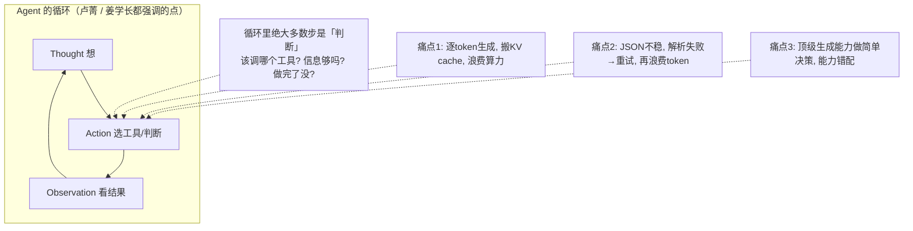
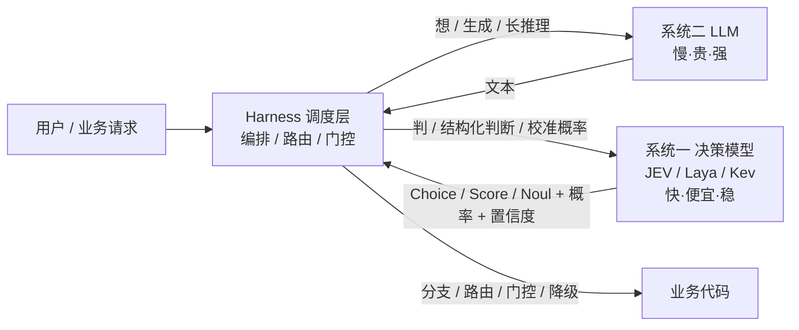
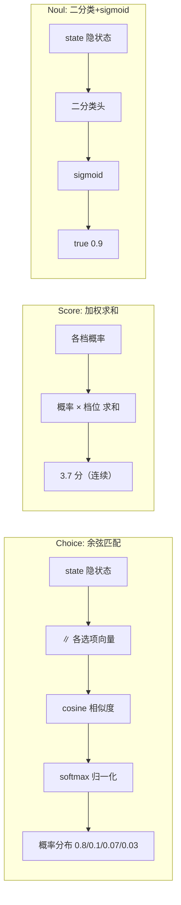
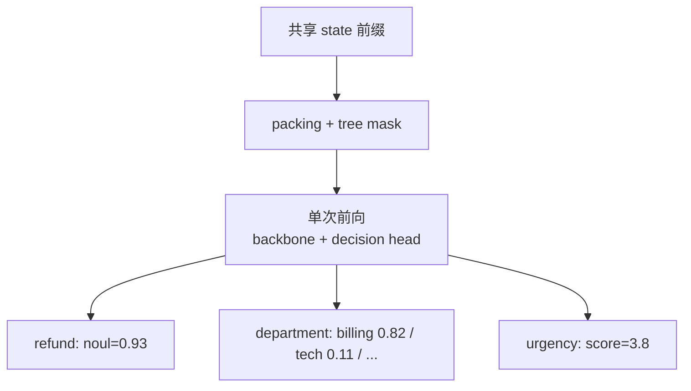
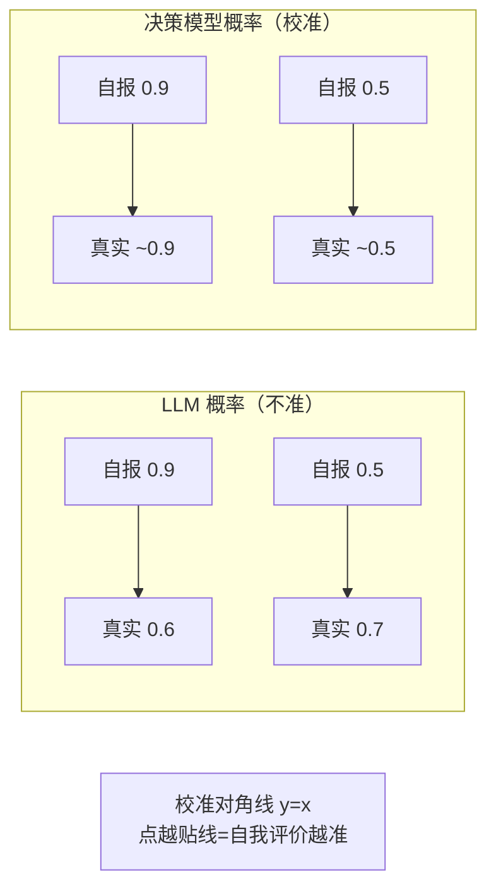
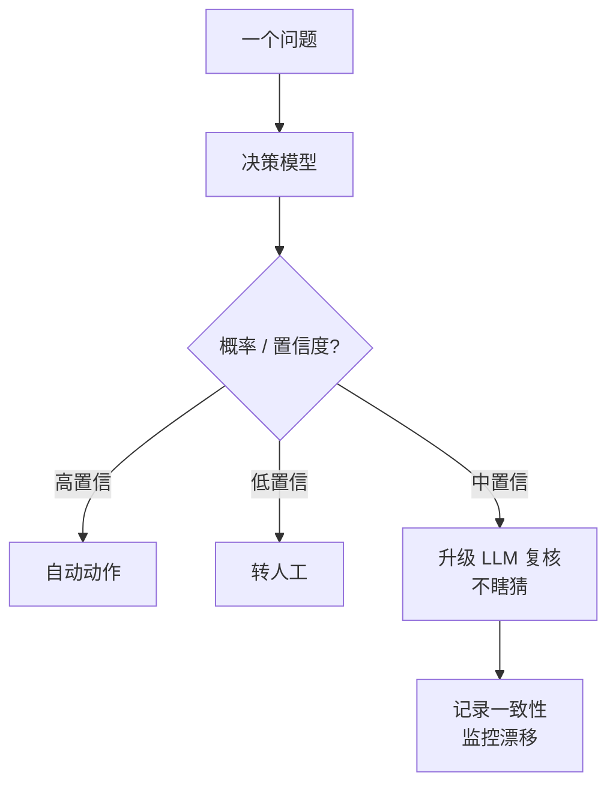
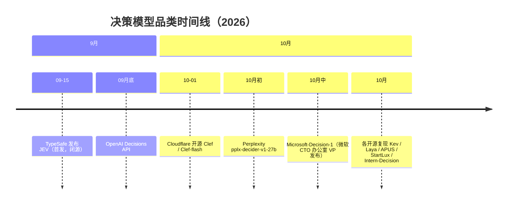

# JEV 与决策模型：一个只做判断的「系统一」模型

> 本文是组内固定技术分享的**配套使用文档**（非 PPT，可自读掌握，不必依赖口头讲解）。  
> 适用对象：搜索 / NLP / Agent 方向的算法工程师。  
> 讲解思路主要参考组内整理的 4 份视频材料（见文末「视频来源」）：清华姜学长《10 分钟讲清楚火爆全网的 JEV》、卢菁博士《Jev 模型工作原理深度拆解》、对应视频转写稿、以及《Jev 模型原理和架构猜测（视频 PPT 还原）》。它们的共同讲法是：**先破题、从痛点出发、用直觉机制讲原理、坦诚哪些是推测、最后给落地的工程经验**。本文沿用这一条线，并把之前梳理过的开源生态、组内菜品匹配场景、十个实测场景、可运行代码作为补充材料嵌进来。
>
> **配套代码**：完整可运行示例在 `code/`（含 `systemone_client.py` 通用客户端 + 11 个示例 + `requirements.txt`）；现场演示 Notebook 在 `notebooks/JEV_live_demo.ipynb`。正文中只放少量示意片段，完整代码一律标注路径。  
> **配图说明**：架构图、机制图、流程图均用 Mermaid 自绘（在支持 Mermaid 的预览器内可直接渲染；导入 PPT/Word 时用 mermaid-cli 导出 SVG/PNG 即可）。  
> **重要边界（务必牢记）**：JEV 目前**未开源、无公开论文**。本文中「架构 / 实现机制 / RLCD 细节」除特别注明「官方事实」外，均来自视频作者的**推测**，卢菁博士自评准确度约 80%。分享时讲「原理」须明确标注「社区推测」，不要把推测当定论。带「*」的性能数字均为厂商自报上限值，非典型生产值，引用务必注明出处。

---

## 〇、先说清楚：为什么值得算法组专门花一次分享

我们日常 pipeline 里大量存在一种环节：给一段文本，判断一个结论——相关性够不够、该归哪个类、要不要转人工、下一步调哪个工具。过去这些要么用 LLM 硬顶（让它输出 JSON 再解析），要么养一堆单任务小模型（BERT/GLiNER）各自维护。

JEV 这类「决策模型」提出的不是「又一个更聪明的聊天模型」，而是把「判断」从「生成」里**剥离**出来，做成廉价、高频、可程序化调用的**基础设施层**。这件事改变的是「我们怎么组织一个 AI 系统」，而不是「模型能干什么」。这正是本期分享值得听的原因。

下面进入正题，我按「先破除误解 → 讲清为什么需要 → 讲清它是什么、怎么工作 → 讲清边界与怎么上手 → 补充开源生态与组内落点」的顺序展开。

---

## 一、破题：两个常见的误解

只看网上的碎片化信息，很容易对 JEV 产生两个误解。先把它们摆出来，后面所有内容都是在消解这两个误解。

**误解一：它又是一个准备去挑战 ChatGPT / Claude 的全能模型。**  
错。它**不写文案、不聊天、不写代码、不生成任何自由文本**。它要做的只有一件事：给你一个类型化的判断（选一个选项 / 打一个分 / 回答是与否）外加一个概率。把「系统二负责想、系统一负责判」拆开的话，它只做系统一。

**误解二：它不就是个普通分类器吗，为什么突然这么多人讨论？**  
表面像，但有两点本质不同：

1. **类别可以动态增减，不用重新训练**。你随时可以把候选集从 4 个改成 40 个，只要把选项写清楚，它就分类；传统意图识别的类别是固定的，BERT 必须事先把所有类定义好、标好数据才能训。
2. **它返回校准过的概率，而不只是一个标签**。普通分类器只告诉你「答案是 A」；决策模型还会告诉你「A 的概率是 0.9」——这个概率能直接拿去做分支、做门控、做降级。

> 一句话概括：**GPT 负责写答案，JEV 负责做判断。** 它不是来替代 LLM 的，而是来补「高频轻量判断」这块过去没人专门优化的空白。


---

## 二、为什么突然火：Agent 时代里「判断」才是真瓶颈

要理解它为什么火，得先看现有的大模型在做 Agent 时，痛点到底在哪。

### 2.1 Agent 的真实工作循环里，95% 是「判断」不是「写\**

一个典型的 Agent 循环是：把用户目标放进大模型 → 大模型决定调哪个工具 → 执行 → 看结果 → 再决定下一步。真正消耗 token、消耗时间的，往往不是「和人对话」，而是循环里海量的**决策**：

> 这条搜索结果有没有用？这两份资料是不是在表达同一个观点？现在的信息够不够？下一步该调工具还是开始写结论？这段结论有没有证据支持？

一个 Agent 表面上「只完成了一次任务」，过程中可能做了成百上千次这种小判断。如果每一个小判断都调一次强通用大模型，延迟和成本会一层层累加。

### 2.2 三大痛点（这是工程师每天在踩的坑）

**痛点一：逐字生成，严重浪费算力。**  
你其实只想要一个 `force` 或者一个布尔值，但自回归 LLM 要一个 token 一个 token 把 `{"decision": ...}` 生成出来。每生成一个 token，都得把数据反复搬进显卡缓存（KV cache），性能大幅下降。相当于「开一辆顶级跑车去农村土路——还不如拖拉机」。

**痛点二：JSON 输出不稳定，导致重试浪费。**  
Agent 一般要求输出 JSON 方便后续解析，但大模型不能 100% 保证格式正确（多字符、少半个括号都常见）。解析失败最常见的做法就是**重试到成功为止**，又浪费大量 token。

**痛点三：「高射炮打蚊子」式的能力错配。**  
我们拿着顶级文本生成能力的「航空级发动机」，去做其实很简单的决策任务。结果既浪费资源，又未必做得好，还费钱费时间。



> **自绘图 1**：Agent 循环里「判断」才是高频消耗点，而现有 LLM 在这类判断上有三大痛点。

JEV 的思路就是：把这些小的判断**单独拿出来**解决——不再逐字生成，而是直接围绕候选答案算概率。它失去了自由表达能力，换来了更低的延迟、更低的成本、更容易被代码处理的结果。

---

## 三、一个朴素的类比：系统一与系统二

理解 JEV 的钥匙，是卡尼曼《思考，快与慢》里的双系统理论。

| 系统           | 特征                 | 例子                  |
| ------------ | ------------------ | ------------------- |
| **系统一（快思考）** | 直觉、高速、潜意识、本能反应     | 看到红灯直接踩刹车；看人脸立刻判断情绪 |
| **系统二（慢思考）** | 需要专注、序列化、高耗能、一步一步推 | 解一道微积分题；写一段代码       |

**关键认知：当前所有开源大模型本质上都是系统二。** 哪怕让「爱因斯坦去踩红灯」，系统二也要动很大的脑，完全没必要。TypeSafe 创始人（前 OpenAI、ChatGPT 共同发明者之一）因此想做一个属于 AI 的**系统一**：直觉式、快速式，只回答「是/否」「A 还是 B」，不输出任何文本。

> 映射到大模型系统：
>
> - **生成式 LLM = 系统二**：逐 token 生成、慢、贵、擅长「想」和「写」。
> - **决策模型（JEV）= 系统一**：单次前向直出结构化判断、快、便宜、擅长「判」。
>
> 系统一**不是**系统二的降级，而是**分工**。人不会因为有了系统二就不再用系统一——恰恰相反，人把大量高频判断交给系统一，只在系统一拿不准时升级系统二。决策模型在 Agent 架构里扮演的正是这个角色。



> **自绘图 2**：决策模型在 Agent 架构中的「系统一」位置。它不替代 LLM，而是与 LLM 分工，由 Harness 统一调度。

---

## 四、JEV 到底是什么：三类判断原语

JEV 接受一段「材料（state）」和几个你预先定义好的「问题（questions）」，返回的不再是文字，而是**选项 / 分数 / 概率**。注意：它**只能输出这三类**，其他一概不输出；任何业务问题都得先转化成这三类之一。

### 4.1 三个原语（primitives）

**① Noul（是非判断）**

- 对一条陈述返回 0–1 的 yes 概率。
- 接近 1 = 强 yes；接近 0 = 强 no；**接近 0.5 = 模型无法判断**（这是最重要的信号，不是 bug）。
- 用途：是否要求退款？这两句话是否矛盾？这条内容是否违规？这一步任务是否完成？
- 响应样例：`{"refund": {"type": "noul", "noul": 0.93}}`

**② Choice（从候选集选一个）**

- 从你给定的候选集（≤255 项）中选一个，返回「选中项 + 每个选项概率分布 + 置信度」。
- 用途：无序类目、归属问题。分给哪个团队？这道菜对应哪个标准菜名？路由到哪条召回链路？
- 强烈建议保留一个 `other` 兜底项：万一真实情况不在候选里，模型至少有地方「说不知道」，而不是强行选一个错的。
- 响应样例：`{"department": {"type": "choice", "choice": "billing", "probabilities": {"billing":0.82,"tech":0.11,"sales":0.04,"other":0.03}, "confidence": 0.82}}`

**③ Score（放到有序量表上）**

- 把状态放到有序量表（2–10 级）上，返回「概率加权分数（可落在两级之间）+ 分布 + 置信度」。
- 用途：有语义梯度的事。客诉严重度（1–5）、紧急度、相关度（0–4）、线索质量（弱/中/强）。
- 关键优势：分数可以落在两级之间（如 2.7），保留了「介于一般和紧急之间」的连续信息。
- 响应样例：`{"urgency": {"type": "score", "score": 3.4, "distribution": {"3":0.6,"4":0.3,"2":0.1}, "confidence": 0.9}}`

### 4.2 直觉实现机制（重点：用「它内部大概怎么算」建立理解）

> 以下机制来自卢菁博士基于公开资料与效果的**推测**（自评 80% 准确度）。但这套「直觉机制」对工程师判断「适不适合用、怎么用」非常有帮助，所以展开讲。

**整体思路**：复用任意 Transformer 基座（DeepSeek、千问等皆可，并非从零训练），**砍掉逐 token 解码**，取最后一个 token 位置的隐状态（一个向量），通过一个特定分类头直接「捞出」答案。

```mermaid
flowchart TD
    In[state 材料 + questions 问题/schema] --> Base[Transformer 基座<br/>任意现有大模型 Qwen/DeepSeek]
    Base --> H[最后 token 位置的隐状态(向量)]
    H --> Head[特定分类头 / 映射头]
    Head --> C[① Choice 多选一+概率]
    Head --> S[② Score 得分]
    Head --> N[③ Noul 真/假+概率]
```

> **自绘图 3**：决策模型推测架构——复用一个 Transformer 基座，取最后隐状态，砍掉自回归解码，经分类头直出三类结果。快的根本原因是「只需一次前向 + 简单映射」，没有逐 token 生成。

**① Choice 怎么算：向量余弦相似度 + 归一化**

1. 取出 state 最后一个 token 的隐状态向量。
2. 把每个**选项的句子/描述**也编码成向量。
3. 计算隐状态与各选项向量的 **cosine（余弦）相似度**，得到若干原始分数。
4. 对分数做 **softmax 归一化**，得到概率分布，如 `[0.8, 0.1, 0.07, 0.03]`。
5. 输出 Top1 及其概率。

> **为什么它比 BERT 强**（卢菁原话精要）：类别可以**任意动态增减**，无需重新训练，只要把选项定义清楚就能分类；BERT 必须事先把类别全部定义清楚、标好数据。如果你觉得它和 BERT 没区别，说明既没理解这套机制，也没理解 BERT。

**② Score 怎么算：概率对分数加权求和**

- 流程与 Choice 相同，先得到各档次（如 1/2/3/4/5 分）的概率。
- 因为这些选项是**同一维度上的不同程度**（相互关联、有序），用概率对分数做**加权求和**，得到 3.7 分、4.3 分这种连续值。

**Choice 与 Score 的本质区别（务必分清）：**

- Choice 的多个选项**完全独立、互不相关**（如技术部/研发部/财务部，类似「分部门」）。
- Score 的多个选项是**同一维度的不同程度**（如及格/良好/优秀，类似「打绩效」）。
- 卢菁金句：「如果你说 Choice 和 Score 没区别，说明你既不理解今天讲的，也不理解分类模型。」

**③ Noul 怎么算：二分类头 + sigmoid**

- 把隐状态过一个**二分类分类头**，再接类似 **sigmoid** 的函数，直接得到概率，如 `true 0.9 / false 0.1`，输出 `true 0.9`。



> **自绘图 4**：三原语的直觉实现机制（社区推测）。左侧 choice 可动态增减选项；中间 score 保留连续梯度；右侧 noul 是带概率的布尔。

### 4.3 一个完整端到端例子（客服工单）

把三种原语放进**一次调用**，看它如何直接驱动业务：

**请求（state 只传一次，三个问题并行）：**

```json
{
  "state": "用户说：我被重复扣款了，请退款。这是本月第二次发生。",
  "questions": {
    "refund":     {"type": "noul",   "instructions": "用户是否要求退款？"},
    "department": {"type": "choice", "instructions": "该分给哪个团队？",
                   "criteria": {"billing": "账单/退款/扣款", "tech": "技术故障", "sales": "销售", "other": "其他"}},
    "urgency":    {"type": "score",  "instructions": "紧急程度（1-5）？",
                   "criteria": ["不急", "一般", "较急", "紧急", "非常紧急"]}
  }
}
```

**响应（业务代码直接分支）：**

```json
{
  "answers": {
    "refund":     {"type": "noul",   "noul": 0.93},
    "department": {"type": "choice", "choice": "billing", "confidence": 0.82,
                   "probabilities": {"billing": 0.82, "tech": 0.11, "sales": 0.04, "other": 0.03}},
    "urgency":    {"type": "score",  "score": 3.8, "confidence": 0.9}
  }
}
```

**业务分支（伪代码）：**

```python
if refund.noul > 0.9 and department.choice == "billing" and urgency.score >= 3:
    auto_issue_refund()        # 高置信 + 明确意图 + 紧急 → 自动退款
elif refund.noul < 0.1:
    close_ticket()             # 不是退款 → 关单
else:
    route_to_human(department) # 中间带 → 转人工，不瞎猜
```

> 这就是「Decisions, not strings」的威力：你拿到的是能直接 `if` 的结构，不是一段要再 parse 的文本。

> 📎 完整可运行示例（含离线 Mock，无 Key 也能跑通结构）：`code/01_basic_primitives.py`（三原语最小调用）、`code/02_batch_parallel.py`（一次 state 多问题并行）。

---

## 五、为什么快又便宜：砍掉了「逐字生成」

### 5.1 非自回归是根本

- **自回归 LLM**：生成「这是退款工单」要逐 token 采样 7 次，每次依赖前面 KV cache，速度受解码步数限制。
- **决策模型**：不做 token 生成，**单次前向传播**直接产出所有结构化值。
- 代价是「不能生成自由文本」——但判断本来也不需要。

### 5.2 一次前向给所有候选并行打分（批量并行的工程核心）

这是「13 个问题一次调用比 13 次快 10×」的来源，值得讲清（社区解构 + PPT 还原一致）：

- **序列打包（packing）**：把「同一个 state + 多个问题 + 多个候选」拼成一批序列，共享 state 前缀。
- **树状注意力掩码（tree mask）**：保证问题之间、候选之间互不串扰，但都能看到公共 state。
- **决策头（decision head）**：在 backbone 之上接轻量 head，把隐藏状态映射成「每个问题/每个选项的 logits」。
- 结果：**一次前向**，同时给「是否退款」「分给哪个团队（含每个团队概率）」「紧急度几分」全部打分。



> **自绘图 5**：一次前向如何给所有候选并行打分（packing + tree mask + decision head）。这正是「批量并行省成本」的来源。

### 5.3 性能数字与成本测算*

> 带 * 的数字均为厂商自报上限值，非典型生产值，分享时务必注明。

- 官方口径：分类决策任务比前沿 LLM 快约 **194–200×**，成本最低约 **445×**（供应商上限）；单次调用端到端延迟约 **70–500 ms**（姜学长实测口径），官方说法单次约 100 ms 量级。
- 批量并行性价比：13 个问题一次调用 vs 顺序 13 次，成本约降 **12.2×**、速度约快 **10×**（只传一次 state）。
- 定价*：输入约 **$0.042 / 百万 token\*\*，\*\*输出 token 免费\*\*（非自回归、无输出计费）。卢菁口播：能力对标顶级模型，价格约其一半（GPT-6 ≈ $0.01，JEV ≈ $0.005），且**只按输入计费\*\*。

**成本测算表（便于组内直接算账）：**

| 场景           | 每千次决策输入 token | JEV 成本*  | GPT-6 Luna 带~500 推理 token* |
| ------------ | ------------- | -------- | -------------------------- |
| 轻量判断         | 2000          | ≈ $0.084 | ≈ $0.465                   |
| 中等（per task） | 5000          | ≈ $0.21  | ≈ $1.16                    |

> 读法：同样「每千次决策、各 2000 输入 token」，JEV 比「带推理 token 的 LLM」便宜约 5.5×。当判断量上亿次/天时，这个差距就是「能不能做」和「做不起」的区别。

**诚实讨论：什么时候决策模型反而不划算**

- 判断量很小（每天几百次）→ 用 LLM 或现有小模型也行，改造代价可能不值。
- 判断高度定制、已有标注数据 + 极致延迟 → 现有 BERT/GLiNER 可能更准更便宜（见第九节）。
- 要开放生成 / 长推理 → 决策模型根本不做这个，别硬用。

---

## 六、核心黑科技 RLCD：让模型有「自知之明」

这一节是 JEV 最该被工程师理解的技术点。它解释了一个核心问题：**为什么决策模型的概率「可以用」，而 LLM 的概率「不可信」**。

### 6.1 为什么「概率准」这么重要

JEV 输出都带分数/概率，所以不仅要求**结果对**，还要求**概率本身准**——这是以往所有大模型都没考虑的。

- 同样是 Top1，概率 **0.9 和 0.6 完全不是一概念**：0.6 可能是「菜鸡互啄」，0.9 才是真高置信。
- 在**强风险隔离的 Agent 场景**尤其关键：让模型执行「删文件」，危险程度 1% 可以删；50% 就该挂 `if/else` 交人判断。

### 6.2 RLCD 训练的是「自我评价 / 自知之明」


**做法（分桶 + 描点）：**
1. 按模型自报置信度把样本分桶——都报 0.25 的放一起、报 0.7 的放一起。
2. 对比真实准确率：100 张图都分成「狗」且自报 0.25，实际只有 30 张是狗，真实准确率 0.3。
3. 以「自报置信度」为横轴、「真实准确率」为纵轴描点；**点越贴近对角线 y=x，说明自我评价越准**。



> **自绘图 6**：RLCD 校准直觉。左：概率与真实正确率脱节（不能门控）；右：概率≈真实正确率（可门控）。

**关键概念区分（卢菁金句）：**
- 「分类准」= 考试分数考得高。
- 「自我评价准」= **估分估得准**（考 200 分估 199，比考 600 却估 650 的人在「估分」赛道更强）。
- RLCD 训练的是后者——**模型对自己答案有多大把握，要与真实正确率匹配**。

> 图像分类里的经典例子（卢菁口播）：早期 LeNet（约 1998 年）即使分对，各类别最高概率也不高、区分能力弱；ResNet 一旦分对概率就很高，自我评价更准（口播举例二者错误率约 44% 与 30% 量级，用以说明概率「可不可用」）。**注意**：这是视频用于说明「概率可不可用」的举例，具体数字请以原始论文为准。

### 6.3 为什么传统大模型「过度自信、爱胡说」

| 原因 | 说明 |
| --- | --- |
| **① 训练目标错位** | 预训练目标是「下一个 token 出现的概率」，只关心字正腔圆（每个字接得对），不关心整句话内容对不对 |
| **② 泛化差距** | 业务多为垂直领域，大模型训练时没见过，无法准确评估自己在该领域的把握 |
| **③ 奖励模型只看对错** | 后训练奖励模型「对了给 1 分、错了给 0 分」，从不考虑概率得分；模型只要答对就拼命抬高概率，导致虚高 |

结果：传统大模型普遍**普通且自信、一本正经地胡说八道**。

### 6.4 RLCD 奖励函数思想（社区推测）

- 传统奖励模型：输入一段话，像数学题一样打勾/打叉（0 或 1）。
- RLCD 在「答案是否正确（0/1）」之外，**新增一项：模型自报置信度与真实答案的差距**。
- 即：不仅要求输出标准答案，还要求输出置信度的准确性，让概率尽可能贴近真实分布。
- 三类输出都可反推概率分布（Choice 取 Top1 概率、Score 反推分布、Noul 天然带概率），统一送入新的奖励模型。
- **RLCD 为作者自创、未公布**；口播提到其简化版本 RCLR / RCD，基本思想应八九不离十。落地流程推测：取标准开源模型作基座 → 对打分/输出头上强化学习 → 调整参数使概率分布尽量与真实一致。

> 工程意义：有了校准概率，你才能写 `if p > 0.9: 自动处理`，并且**相信**这个 0.9。这是决策模型能「替代人工兜底逻辑」的前提。

---

## 七、优势、边界与误用（先讲边界，才用得稳）

### 7.1 四大优势（姜学长原话）

1. **快**：一次决策通常 70–500 ms，对浏览器操作、实时审核、Agent 路由这类连续高频任务，体验差异直接显现。
2. **便宜**：输入约 $0.042 / 百万 token，输出免费；当系统每天完成几万、几十万次判断时，成本差距被无限放大。
3. **输出稳定**：你给 5 个候选，它就只在这 5 个里返回，不会创造第 6 个答案，也不用从自然语言里再提取结论。
4. **返回概率**：普通分类器只告诉答案是什么；决策模型把「置信程度」也交给程序——把握高自动执行，把握一般交更强模型复核，把握太低或涉高风险动作转人工。

> **必须区分两件事**（姜学长强调）：输出格式稳定 ≠ 判断一定正确。决策模型不会在格式上胡来，但**完全可能在合法选项里选错**。所谓「不产生自由文本幻觉」，解决的是「格式」问题，不是「准确性」问题。

### 7.2 它做不了的（每个都配一个失败案例）

- **精确算术/计数**：问「列表里有几个 item？」可能数错。→ 计数交给代码。
- **跨日期有序比较**：问「A 日期是否晚于 B 日期？」容易错（尤其跨月/跨年）。→ 用 `datetime` 比较。
- **数值邻近**：问「19.99 和 20.01 是否接近？」边界不稳。→ 用阈值代码。
- **双重否定**：「用户说『我不不需要退款』」这类，Noul 容易翻车。→ 关键路径仍要 human-in-the-loop。
- **长上下文「腐烂」**：把整本手册塞进 state，无关信息稀释判断质量。→ state 要精简，只放决策相关上下文。

### 7.3 中文（CJK）准确率偏低 —— 对我们尤其关键

- TypeSafe 自述在中文等非英文语言上准确率更低（训练数据以英文为主）。
- **怎么办**：中文场景**优先测开源中文基座**（Kev / StartLux / Laya-multilingual / Clef / Strands / Microsoft-Decision-1，全都跑在 Qwen 系上，见第九节）。**别直接把原版 JEV 的英文成绩平移到中文任务**——这是最容易踩的坑。

### 7.4 置信度 ≠ 正确性；格式正确 ≠ 语义正确

- 决策模型保证「从你给的 A/B/C 里返回一个合法候选」，但完全可能选错 B。它不会越界，但会选错。
- 严谨说法：「决策模型不会给出候选范围之外的结果，同时提供一个可被程序控制的概率信号。」**这个概率信号要配合门控 + 降级 + 人工兜底才安全**（见第十节）。

---

## 八、怎么上手才不会翻车（姜学长的工程经验）

这部分是视频里最值钱的经验，直接决定你是用得好还是用翻车。

### 8.1 真正难的不是接 API，是「把问题定义清楚」

> 反例（姜学长原话）：用户说「我买的东西一个星期没到，现在不想要了」。如果选项只有「物流延迟」和「申请退款」，这个单选题本身就设计得不好——物流延迟是原因，申请退款是诉求，它们可以**同时成立**。模型不会替你修复一套混乱的业务标准；信息不完整、问题不明确、选项互相重叠，速度再快也没用。

**稳妥的上手方法：**
1. 选一个**范围小、答案清楚**的任务。
2. 找一批**已经有人工处理过的历史数据**，让决策模型在旁边跑，**暂时不要参与真实操作**。
3. 观察它在哪些任务上稳定，**置信度和真实正确率是不是匹配**。
4. 再根据风险设定：自动通过 / 模型复核 / 人工处理。

### 8.2 先 shadow，再灰度，别一上来 enforce

- **shadow（影子）**：决策模型结果与现有方案并跑，比对一致性，不接真实动作。
- **canary（金丝雀）**：小流量用决策模型自动处理，监控准确率 / 人工复核率。
- **enforce（全量）**：高置信自动、中低置信降级，才全量。

### 8.3 输出稳定 ≠ 判断正确；标准错会更快重复错

- 决策模型买来的不只是「快」，更是「让原本因成本太高而不存在的判断开始大量出现」。
- **但更多判断不一定自动带来更好结果**：如果标准本身就错了，系统只是更快、更便宜地重复错误。所以标准的定义、校准曲线的核验，比「接上 API」重要得多。

### 8.4 阈值门控 + LLM 降级（决策模型拿不准就上 LLM，不瞎猜）

```python
from systemone_client import SystemOneClient   # 见 code/systemone_client.py

def decide(client, state, question, llm_fallback, thr=0.9):
    r = client.ask(state, {"q": question})["answers"]["q"]
    if question["type"] == "noul":
        p = r["noul"]
        if p > thr:    return ("yes", p)        # 高置信自动
        if p < 1-thr:  return ("no", 1-p)        # 高置信自动
        return llm_fallback(state, question)     # 中间带 → 上 LLM/人工
    if r.get("confidence", 1) < 0.6:             # Choice/Score 用阈值工程选的阈值
        return llm_fallback(state, question)
    return (r["choice"] if question["type"]=="choice" else r["score"], r.get("confidence"))
```

> 要点：降级不是失败，是「把不确定的交还更贵的系统」——这正是决策模型性价比的来源。



> **自绘图 7**：置信度门控 + 降级控制流（姜学长 + 卢菁共同强调的落地方式）。

---

## 九、开源生态：闭源之外我们还能用什么（补充材料）

> 这一段 B_ 视频讲得少，用我们之前梳理的材料补上——因为**原版 JEV 闭源、对中国大陆未开放、数据要出境**，对我们有数据合规要求的场景（菜品匹配涉及商户数据、搜索涉及用户 query）基本不能直接上生产。好消息是 JEV 发布约两周内行业集体跟进，开源/可本地部署方案大量涌现。

### 9.1 决策模型品类时间线（2026）



**关键观察**：这一轮决策模型的「躯干」大量是**中国开源基座 Qwen**——Clef、Strands Decider、APUS、Microsoft-Decision-1 都跑在 Qwen 上。闭源 JEV 留下的「本地化 / 数据不出域」缺口，正好被开源中文基座补上。

### 9.2 ★ 重点深讲：Laya（部署 + 微调，算法工程师日常可用）

按判断，开源生态里挑 **Laya** 重点讲——它是目前**最贴合「私有化 + 中文 + 能自己训」**的一个，且文档/配方最完整，工程师今天就能动手。

**为什么是 Laya**：Convai Innovations 出品，Apache-2.0；与 JEV 同范式（choice/score/noul、校准概率、单次前向、无文本生成）；**提供多语言 checkpoint（含中文友好）**；Jev 兼容 `/v1/systemone` 接口；体量小（322–421M）本地毫秒级；**附带可复现微调配方**。

**架构一页纸**：双向编码器（ModernBERT-large 421M 英文 / mmBERT-base 322M 多语言）→ 决策 Transformer + scoring/action heads → 校准概率输出。用双向编码器是因为判断不需要因果掩码下的自回归生成，而是「看完整个 state 给一个判断」——双向注意力（像 BERT）天然更适合「编码后判断」，且比因果 LM 快。

**三个官方 checkpoint（HuggingFace）**：`convaiinnovations/laya`（英文 421M）、`convaiinnovations/laya-multilingual`（多语言含中文，322M，**我们优先**）、`convaiinnovations/laya-typed-decisions`（typed-decisions 工作流）；MLX FP16：`aac6fef/laya-mlx`。

**四种部署（什么时候用）：**
1. **CLI 一行命令**（最快试用）：`pip install laya` → `laya "我被重复扣款了，请退款。"`——验证范式、本地手测。
2. **HTTP 服务 / Jev 兼容**（推荐接入现有链路）：`pip install "laya[serve]"` → `LAYA_DEVICE=cuda LAYA_PRELOAD=1 laya-serve`，暴露 `POST /v1/systemone`，与 JEV API 同格式——把现有 JEV 请求地址换成 Laya 本地地址即可零改造接入。
3. **Docker（CPU + CUDA，服务化）**：`docker compose -f compose.yaml -f compose.http.yaml up --build laya-serve`——生产服务化、容器编排。
4. **Laya-MLX（Apple Silicon 原生，无 PyTorch）**：`pip install laya-mlx`，内存 <1GB，M 系列毫秒级——本地开发机跑决策，无需显卡。

**微调（把 Laya 变成「我们的」判断模型）**：官方提供 Kaggle Notebook，免费 2×T4 GPU 上约 4–5 小时跑完整流程：构建决策数据集 → RLCD 训练 → 温度拟合 → 评估 → 推 Hub。数据集长这样（菜品匹配示意）：

```json
{"state": "用户下单：宫爆鸡丁", "questions": {
   "isequal": {"type":"noul","instructions":"是否与标准菜『宫保鸡丁』为同一道菜？"},
   "std": {"type":"choice","instructions":"归属哪个标准菜名？",
           "criteria":{"宫保鸡丁":"...","鱼香肉丝":"...","other":"其他"}}}}
```

**校准坑（务必讲，避免翻车）**：某版本把拟合温度 clamp 到 [0.5, 5.0]，否则某个 bucket 原始温度 0.1006 会把 logits 锐化约 10×，把「抛硬币」报成「近乎确定」。**微调后一定要在你的数据上画校准曲线（reliability diagram），别直接信「概率=准确率」**。

> 📎 完整可运行示例：`code/06_laya_local.py`（Laya-MLX 本地推理）、`code/07_laya_serve.py`（FastAPI 暴露 `/v1/systemone`）、`code/10_finetune_laya.py` + `code/10_finetune_laya.md`（端到端微调骨架）。

### 9.3 其他开源/闭源同类一览

| 项目 | 路线 | 协议 | 特点 |
| --- | --- | --- | --- |
| **Kev** | Qwen3.5 | Apache 2.0 | 兼容 `/v1/systemone`；0.8B 无 GPU 可跑；推荐 4B 起 |
| **OpenJev** | DiffusionGemma + vLLM | 开源 | 同时给文本生成接口 |
| **APUS fast-browser-use** | Qwen3.5-9B | MIT | 单 token logits 决策 + KV-Cache 广播，浏览器自动化 |
| **NanoJev** | 0.6B 并行决策 | 开源 | 附训练资料，适合研究 |
| **Intern-Decision** | 多模态 | 开源 | 看懂图/界面再决策 |
| **StartLux-Decision** | Qwen 后训练 | 开源 | 0.8B–27B 五档，配齐量化 |
| **Clef / Clef-flash** | Qwen 后训练 | Apache 2.0 | Cloudflare Workers AI 托管 |
| **Strands Decider 2B** | Qwen 2B + pointer head | Apache 2.0 | 开源权重+训练数据+脚本，最「可复现训练」 |
| **Microsoft-Decision-1** | Qwen3.5-9B 后训练 | 闭源托管 | 大厂正式下场标志 |

### 9.4 两个必看的中文/生态入口

- **Awesome Jev（fatwang2/awesome-jev）**：生态总目录。与日常最相关的工具：`jevcal`（在你的数据上选满足准确率目标的阈值、算还需多少流量走 LLM、模型更新破坏时让 CI 失败——直接对应我们的阈值工程）；`jevfire`（批量并行过 vLLM）；`jevmlx`（一次前向拼出合法 JSON，不会产出非法 JSON）。
- **Datawhale jev-cookbook（datawhalechina/jev-cookbook）**：最适合中文工程师的系统入口。11 章 + 18 篇实战配方（重排序/语义搜索/函数调用/引用核查/防护栏 等，几乎是搜索/NLP 日常模板）+ 第 6 章「无重试无回退、预算记账」的诚实评测纪律 + 第 9–10 章 Agent 集成与 Laya RLCD 微调全流程。**无需 API Key 可离线跑**。

### 9.5 决策模型 vs BERT / GLiNER（讲透）

| 维度 | 传统分类器（BERT/GLiNER） | 决策模型（JEV/Laya） |
| --- | --- | --- |
| 训练 | 每类目单任务管线、持续标注 | 零样本迁移、问题空间可变 |
| 多任务 | 一个模型一件事 | 同一模型多任务复用 |
| 概率 | 无校准保证 | 校准概率（可门控） |
| 泛化 | 只懂训练分布 | 基础模型泛化 |
| 维护 | 数据漂移要重训监控 | 换基座/微调即可 |

**结论**：决策模型**不是替代 BERT**，而是把「判断」做成可复用、可校准、可阈值化控制的**基础设施层**。高频固定类目 + 有标注数据 + 极致延迟的场景，现有小模型仍能打，**先别急着换**；增量价值在：零样本泛化、问题空间多变、要校准概率做自动分支。

---

## 十、落到我们组：菜品匹配与十个实战场景（补充材料）

> 这一段把前面通用技术落到我们的日常工作。十个场景直接参考组内 PPT《Jev：10 个使用场景》（整理自 TypeSafe 官方资料 + B站「雷哥AI」实测）。

### 10.1 菜品匹配（你主做，天然适配 —— 完整方案设计）

**① 问题拆解（三种判断映射）**
- `is A==B`（同一道菜不同写法，如「宫爆鸡丁」vs「宫保鸡丁」）→ **Noul**。0.5 附近转人工/上 LLM。
- 候选标准菜名归属（如「鱼香茄子」归到标准库哪个条目）→ **Choice**（≤255 项标准库，加 `other`）。
- 相似度/置信分级（如「微辣宫保鸡丁」与「宫保鸡丁」的接近度）→ **Score**（可落两级之间）。

**② 置信度驱动的分流策略**
- 高置信（Noul>0.9 或 Choice confidence>0.85）→ 自动合并/归一。
- 低置信（Noul<0.1 或明确 other）→ 自动归新类/拒绝。
- 中置信 → 上 LLM 复核或转人工标。

**③ 数据闭环**：把历史「用户写法 → 标准菜名」标注沉淀为决策数据集，在 `laya-multilingual` 上 RLCD 微调（见 9.2），本地服务化后比基础版准很多、数据不出域。

**④ 灰度上线**：shadow（并跑比对）→ canary（小流量自动合并，监控准确率/人工复核率）→ enforce（高置信自动、中低置信降级）。

> 这份设计可直接作为 POC 立项依据。

> 📎 完整可运行示例：`code/04_dish_matching.py`（菜品判等/归属/分级 + 标注数据集样例 + 与现有方案 A/B 钩子）。

### 10.2 十个社区实测场景（速查表）

| # | 场景 | 原语 | 解决什么 | 关键做法 / 数字 |
| --- | --- | --- | --- | --- |
| 01 | 收件箱自动分类 | Choice | 邮件分文件夹 | 文件夹=选项，不确定留人工；500 封约 $0.035（实测） |
| 02 | 关键词意图归类 | Choice | 搜索意图识别 | informational/commercial/transactional 逐行标注 |
| 03 | 销售线索评分 | Score | 线索质量 | 弱/中/强 + 话术匹配度；「不匹配」红列最有价值 |
| 04 | 模型 / 工具路由 | Choice | 成本优化 | 便宜/均衡/旗舰自动选，成本降约 70% |
| 05 | 编码智能体上下文压缩 | Noul | 省 token | 逐条判工具记录该留/删；记忆 13000→2756 token 约 $0.003 |
| 06 | 浏览器操作选择 | Choice | computer-use | 每步选「动作+元素」，观察后再要下一步 |
| 07 | 搜索结果重排序 | Choice/Score | RAG 质量 | RAG 前先过滤无关/过时/冲突文档 |
| 08 | 发布质量红绿灯 | Noul×3 | 内容质量门控 | 是否答意图/有无无来源断言/内链合理，绿黄红分流 |
| 09 | 智能体护栏 | Noul | 安全 | 输入/输出风险评估，危险即阻断 |
| 10 | 内容审核 / 工单分流 | Choice/Score | 审核效率 | 评论/工单秒级分类 + 升级人工 |

> **PPT 原话结论（最该记住的一句）**：决策模型最有用的不是「它多快」，而是「**它会告诉你哪些它没把握**」——把不确定的那列交还人类，而不是悄悄猜错。这正是阈值门控 + 评测纪律的底层逻辑。
> 出处：组内 PPT《Jev：10 个使用场景》（整理自 TypeSafe AI 官方资料 + B站「雷哥AI」实测）。数字为原作者实测，引用时注明。

### 10.3 搜索 / NLP 最现成（cookbook 第 4 章 18 篇配方即模板）

| 子任务 | 原语 | 对应 cookbook 配方 | 说明 |
| --- | --- | --- | --- |
| 相关性判定 / 重排 | Noul / Score / Choice | 重排序、语义搜索 | query–doc 相关先过滤，再进重排/LLM |
| 语义路由 | Choice | 意图路由 | 把请求路由到正确召回链路/模型 |
| 蕴含 / NLI | Noul | — | 两句话是否矛盾/蕴含 |
| 防护栏 / 安全门 | Noul + 阈值 | 防护栏 | 输入是否违规/越权 |
| 函数/工具调用 gate | Choice | 函数调用、引用核查 | 给 LLM 前先判「该不该调、调哪个」 |
| 上下文压缩 | Noul 逐条 | — | 哪些历史片段该保留 |


> 📎 完整可运行示例：`code/05_search_relevance.py`（query–doc 相关性 + 重排序过滤层）、`code/11_agent_guardrail.py`（工具调用前风险门控 + 完成验证 + 危险阻断）。

### 10.4 评测纪律（别被厂商榜带偏）

- 复用 cookbook 第 6 章诚实评测：231 道公开题**四维**（准确率 / 底线率 / Brier / ECE），无重试、无回退、预算记账。**关键：不只看准确率，还要看校准（ECE/Brier）**——决策模型买的正是校准概率，光看准确率会误判。
- **自建中文评测集**（菜品匹配 / 搜索相关性），A/B 对比决策模型 vs 现有 BERT/GLiNER/LLM：**四项齐报**——准确率 + 成本 + 延迟 + 校准。
- 阈值用 `jevcal` 式方法在你的数据上选，别拍脑袋；榜单（DecisionIndex / JevBench）数字审慎引用——它们是「选出来的上限」不是典型值。

> 📎 完整可运行示例：`code/08_eval_chinese.py`（中文评测集构造 + 四维指标，纯 numpy 实现）、`code/09_threshold_selection.py`（阈值选择 + 流量测算）、`code/03_confidence_gate.py`（门控+降级，含阈值扫描）。

### 10.5 MVP 落地清单（直接参考组内 PPT）

1. **选试验田**：挑一个「选项已知、量大、要快」的流程（如邮件/工单分类）先试，别一上来重构核心链路。
2. **写显式标准**：把判断写成 true/false 条件，别让模型自己「猜你的标准」。
3. **设置信度阈值**：低于阈值一律交还人类，绝不自动动作——这是 Jev 用好的核心。
4. **先做过滤层**：让决策模型坐在「检索/路由」与「大模型」之间，把难的挑出来，省钱又稳。
5. **代码算数**：计数/比较/日期交给代码，决策模型只做有界判断，别让它算数。

---

## 十一、收尾：一句话带走

JEV 不是「会思考的聊天模型」，而是 Agent 架构里的「**廉价高频判断层**」——系统二负责想、系统一负责判，Harness 负责调度。它可能让原本因为成本太高而不存在的判断开始大量出现；但**更多判断不一定自动带来更好结果**，标准错了只会更快更便宜地重复错。

对我们组的行动建议：① 盘点 pipeline 里所有「判断型」LLM 调用；② 选 POC（**强烈建议菜品匹配 / 搜索相关性判定**）；③ 自建中文评测集 A/B（准确率+成本+延迟+校准）；④ 若做 Agent，先在小接缝（工具安全门、完成验证）shadow → canary → enforce；⑤ 中文优先测 Qwen 系开源基座（Laya-multilingual + RLCD 微调），数据不出域。

---

## 视频来源（本文讲解思路主要来自以下 4 份组内整理材料）

- 清华姜学长《10 分钟讲清楚火爆全网的 JEV》视频转写稿（B站 BV1yoaK6gE34），对应 `B_10分钟讲清楚火爆全网的JEV_原始.md`。
- 卢菁博士《Jev 模型工作原理深度拆解》整理稿（B站 BV1PzhU6fErg），对应 `B_Jev模型工作原理深度拆解.md`、`B_Jev模型工作原理_转写.md`。
- 《Jev 模型原理和架构猜测（视频 PPT 还原）》（22 页 PPT 文字提取），对应 `B_Jev模型原理和架构猜测（视频PPT还原）.pptx`。

> 以上材料中的「架构 / 实现机制 / RLCD 细节」除标注「官方事实」外均为视频作者推测（卢菁自评约 80% 准确度），本文沿用其讲法并保留该边界标注，分享时请勿将推测当作定论。

## 参考文献

> 说明：带「\*」的性能数字为厂商自报，非典型生产值，引用请注明。开源项目与官方链接以实时版本为准。

**一、官方与发布**
1. TypeSafe AI 官网：https://jevtypesafe.org
2. TypeSafe AI 文档：https://docs.typesafe.ai
3. JEV Playground：https://jevplayground.com

**二、技术解构 / 冷静分析**
4. HN Today（RLCD + packing + mask 解构）：https://www.hntoday.co
5. BestHub（fast/slow 架构 shift、ModernBERT 自托管示例）：https://bestblogs.dev
6. EulerFold（架构蓝图）：https://eulerfold.com

**三、开源项目（复现 / 兼容层）**
7. Kev（jaredpalmer/kev）：https://github.com/jaredpalmer/kev
8. OpenJev（razorback16/openjev）：https://github.com/razorback16/openjev
9. APUS fast-browser-use：https://github.com/apus-ai/fast-browser-use
10. Laya（Convai Innovations）：https://huggingface.co/convaiinnovations
11. Laya-multilingual：https://huggingface.co/convaiinnovations/laya-multilingual
12. Laya-MLX（aac6fef）：https://huggingface.co/aac6fef/laya-mlx
13. NanoJev：https://github.com/TianyuCodings/NanoJev
14. Intern-Decision（上海AI实验室）：https://github.com/OpenGVLab/InternDecision
15. StartLux-Decision：https://github.com/OriginStarHui/StartLux-Decision

**四、闭源 / 托管同类**
16. OpenAI Decisions API：https://openai.com
17. Perplexity pplx-decider-v1-27b：https://huggingface.co/perplexity-ai
18. Cloudflare Clef：https://github.com/cloudflare/Clef
19. AWS Strands Decider：https://github.com/strands-agents/decider
20. Microsoft-Decision-1：https://github.com/datawhalechina/jev-cookbook

**五、基准 / 评测**
21. JevBench：https://github.com/fstandhartinger/jevbench
22. Decision Index（multimodalart）：https://huggingface.co/spaces/multimodalart/decision-index
23. S1MB / sysone-bench / Cua-Bench-S1：https://github.com/Benchmark-Heaven

**六、生态索引 / 中文学习入口**
24. Awesome Jev（fatwang2/awesome-jev）：https://github.com/fatwang2/awesome-jev
25. Datawhale jev-cookbook：https://github.com/datawhalechina/jev-cookbook （在线阅读：https://datawhalechina.github.io/jev-cookbook/ ）
26. Jev-Mem：https://github.com/libingzheren/Jev-Mem

**七、内部资料**
27. 组内 PPT《Jev：10 个使用场景》：同分享目录 `..\2026-10-11-09-41-32\Jev使用场景.pptx`（整理自 TypeSafe AI 官方资料 + B站「雷哥AI」实测）。

---

> **配套代码与 Notebook**：见同目录下 `code/`（通用客户端 `systemone_client.py` + 11 个 Python 示例 + `requirements.txt`）与 `notebooks/JEV_live_demo.ipynb`。所有完整可运行代码均不在正文中展开，按上文「📎 完整可运行示例」标注的路径查阅。
> **自绘图清单**（均用 Mermaid，可在支持预览器中渲染，或导出 SVG/PNG 用于 PPT/Word）：图1 Agent 循环与痛点；图2 系统一/系统二架构；图3 决策模型推测架构；图4 三原语直觉机制；图5 一次前向并行打分；图6 RLCD 校准直觉；图7 门控降级控制流。
