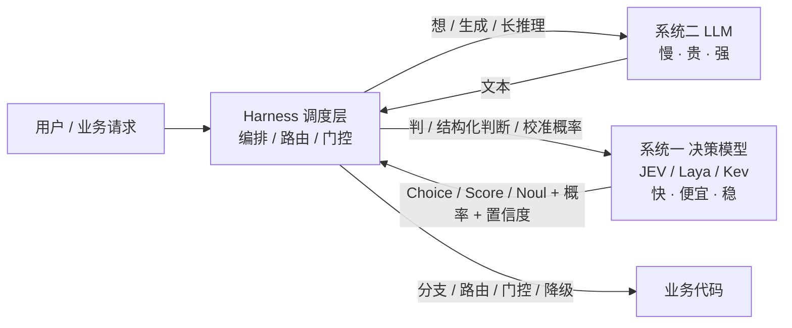
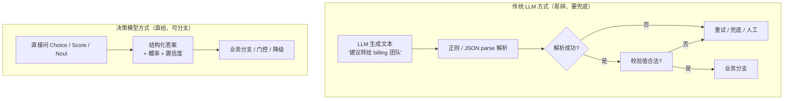
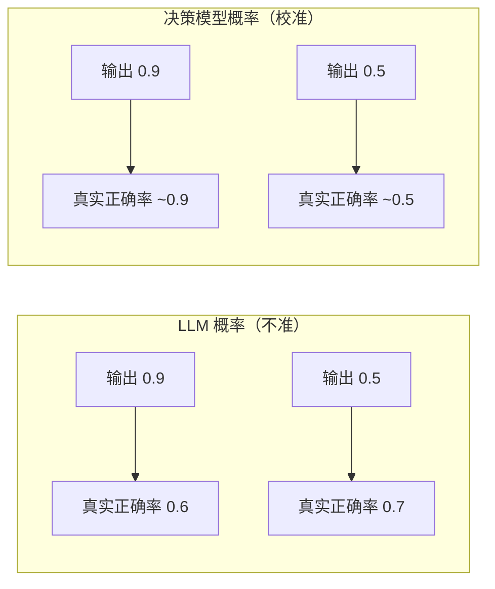
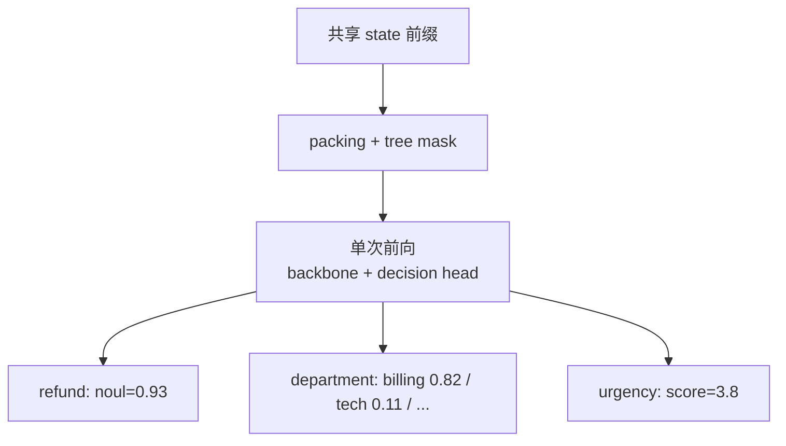
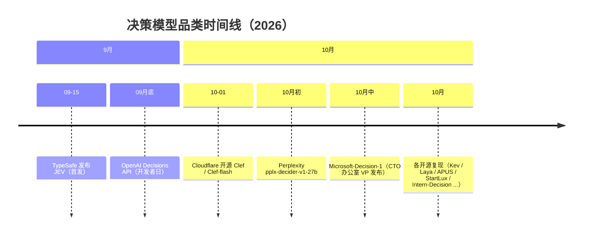
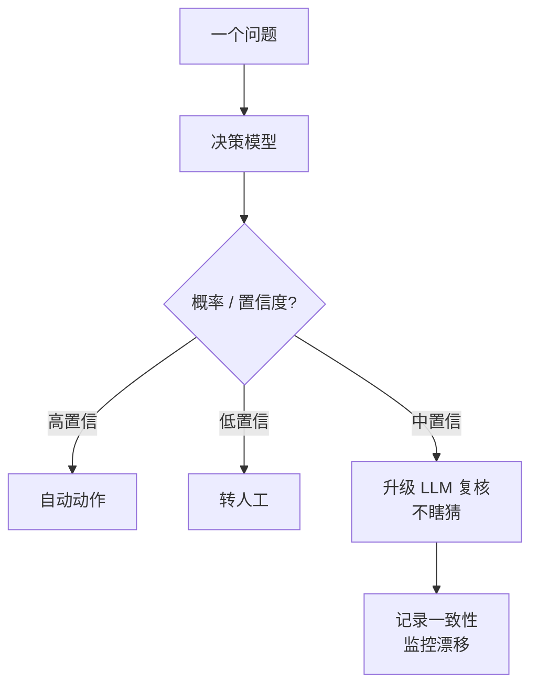
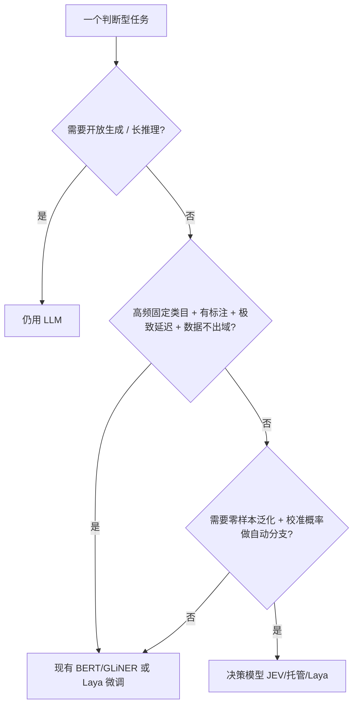

# JEV 与决策模型（Decision Models）：Agent 时代的「快思考」基础设施（详版）

> **文档定位**：组内技术分享（使用文档，非 PPT）。适用对象：搜索 / NLP / Agent 方向的算法工程师。  
> **建议时长**：75–90 分钟。本文档刻意写得详尽，目的是「直接读文档、稍加理解即可掌握，不依赖口头讲解」。  
> **配套资源**：可运行代码在 `code/`（11 个 Python 文件 + `requirements.txt`）；现场演示 Notebook 在 `notebooks/JEV_live_demo.ipynb`。正文中只保留少量**示意片段**，完整代码一律见 `code/` 并标注路径。  
> **资料来源**：TypeSafe 官方文档、网络公开报道、社区复现项目、第三方基准，以及组内 PPT《Jev：10 个使用场景》（2026-09~10）。带「\*」的性能数字为厂商自报上限值，非典型生产值，引用时务必注明出处。  
> **配图说明**：架构图、数据流图、流程图均用 Mermaid 语法自绘（在 VS Code / Typora / GitHub / WorkBuddy 等支持 Mermaid 的预览器中可直接渲染；导入 PPT/Word 时可用 Mermaid Live / mermaid-cli 导出 SVG/PNG）。官方架构图与基准图表以**链接引用**给出，未做热链以免失效；如需在文档内直接看到图，建议从对应官网抓取确切图片 URL 后嵌入。本文「需要自绘的图」清单见每节图注。

---

## 目录

1. [开场：为什么是「决策模型」而不是「又一个大模型」](#开场)
2. [第一部分：JEV 是什么](#第一部分jev-是什么)
   - 1.1 来龙去脉与命名（杰文斯悖论 / 系统一系统二 / 为什么是现在）
   - 1.2 核心定位：Decisions, not strings（三原语逐一拆解）
   - 1.3 技术原理（非自回归 / RLCD 校准 / 并行采样 / 工程解构）
   - 1.4 为什么快、为什么便宜（成本测算）
   - 1.5 JEV 的边界（真实失败案例 + 误用警示）
3. [第二部分：开源生态](#第二部分开源生态)
   - 2.1 为什么需要开源替代
   - 2.2 闭源 / 托管同类（含「决策模型时间线」）
   - 2.3 开源 / 可本地部署清单（逐项目展开）
   - 2.4 ★ 重点深讲：Laya（部署 + 微调，算法工程师日常可用）
   - 2.5 生态索引 & 中文学习入口（awesome-jev + Datawhale cookbook）
   - 2.6 决策模型 vs BERT / GLiNER
   - 2.7 评测基准：怎么选、怎么评估
4. [第三部分：对我们组算法工程师日常有用的东西](#第三部分对我们组算法工程师日常有用的东西)
   - 3.1 心智模型（pipeline 改造前后对比）
   - 3.2 直接可套的场景（搜索/NLP · 菜品匹配完整方案 · 十个实测场景 · Agent）
   - 3.3 工程接入（门控 / 批量 / 监控骨架）
   - 3.4 评测纪律（四维指标 + 中文评测集怎么建）
   - 3.5 选型决策树（讲透）
   - 3.6 风险与误用（真实事故式警示）
   - 3.7 MVP 落地清单
5. [收尾](#收尾)
6. [参考文献](#参考文献)

---

## 开场

**一句话钩子**：有一个「不写任何字、只做判断」的模型，发布三周处理 Token 约 1 万亿、约 1/4 的世界 500 强已接入；它由前 OpenAI 研究员、RLHF/ChatGPT 的共同发明者创立，种子轮 4000 万美元。它不是「更聪明的聊天模型」，而是把「判断」从「生成」里**剥离**出来，做成廉价、高频、可程序化调用的**基础设施层**。

> 为什么这件事值得一个算法组专门花时间听？因为决策模型改变的不是「模型能干什么」，而是「我们怎么组织一个 AI 系统」：**把高频、固定形态的判断从又贵又慢的生成模型里抽出来，单独用一个便宜的模型做**。这恰恰是我们日常 pipeline 里大量存在的环节——相关性判定、类目归属、是否转人工、该调哪个工具——过去我们都用 LLM 硬顶，或者用一堆单任务小模型维护。决策模型给出了一条可能更优的组织路径。

**本次分享三段结构**（注意：第一、二部分以通用技术/生态为主，不强行绑定组内场景；第三部分才重点落到我们的日常工作）：

1. **JEV 本体**：是什么、为什么快、技术原理、能力边界。
2. **开源生态**：闭源同类 + 开源/可本地部署 + 与传统小模型对比 + 评测基准。
3. **对我们组有用**：心智模型、可直接套的场景、工程接入、选型、风险。

---

## 第一部分：JEV 是什么

### 1.1 来龙去脉与命名

#### 1.1.1 TypeSafe AI 是谁

- **发布时间**：2026-09-15，从 stealth（隐身）状态直接发布 JEV，是其首个公开模型。
- **创始团队**：
  - **Diogo Almeida**：前 OpenAI，RLHF / InstructGPT / ChatGPT / GPT-4 的核心成员之一，也是 ChatGPT 的共同发明者。
  - **Erik Gafni**、**Sasha Sheng**：联创。
- **融资**：4000 万美元种子轮，DCVC 领投，估值约 2 亿美元。
- **为什么这些人出来做「判断」而不是「又一个聊天模型」**：核心团队亲历了 ChatGPT 时代「用 LLM 当判断器」的全部痛苦——你要让模型输出 `true/false`，它偏给你写一段散文；你要让它选 A/B/C，它给你一个「建议选 B，但也要考虑 A」的段落，你还得分辨、校验、兜底。**他们是做 RLHF 的，最清楚「对齐一个模型只做判断、且把概率校准好」在工程上有多值钱**。JEV 可以理解为：把 InstructGPT 里「指令遵循 + 校准」的那部分能力，单独抽出来做成一个产品。

#### 1.1.2 名字来源：杰文斯悖论（Jevons Paradox）

JEV 取自 19 世纪经济学家 **William Stanley Jevons（杰文斯）**。理解这个命名，是理解整个产品假设的关键：

- **原版悖论**：1865 年，杰文斯观察到——蒸汽机烧煤的效率大幅提升后，煤炭总消耗量**不降反升**。因为「更便宜地用煤」打开了无数以前用不起煤的新用途，总盘子被放大了。
- **现代类比**：
  - LED 比白炽灯省电约 80%，但全球照明总耗电没降，反而因为「灯更随便开、到处装」而上升。
  - 云计算单位算力变便宜，总算力消耗暴涨。
- **TypeSafe 的产品假设（也是本次分享的核心论点之一）**：把「判断」这个动作做到**极便宜、极低延迟**，会催生海量以前因为「用 LLM 做判断太贵/太慢」而不存在的用法。判断不再是需要「慎重调用一次大模型」的奢侈品，而是可以「每条请求都顺手做十几次」的日用品。

> 把这个想通，你就明白为什么 JEV 把「输出 token 免费」「非自回归单次前向」「批量并行」当成卖点——它赌的是**用量**，不是单价。

#### 1.1.3 System One：卡尼曼的「快思考与慢思考」

TypeSafe 把 JEV 称为 **System One 模型**，借的是 Daniel Kahneman《思考，快与慢》的著名二分法：

- **系统一（快思考）**：直觉式、自动化、低功耗、并行、不假思索。比如看到「2+2」立刻知道是 4，看到人脸立刻判断情绪。
- **系统二（慢思考）**：需要专注、序列化、高耗能、一步一步推。比如做一道几何证明，或写一段代码。

**映射到大模型系统**：
- **生成式 LLM = 系统二**：逐 token 生成、慢、贵、适合「想」和「写」。
- **决策模型（JEV）= 系统一**：单次前向直出结构化判断、快、便宜、适合「判」。

> 重要认知：**系统一不是系统二的降级，而是分工**。人不会因为有了系统二就不再用系统一——恰恰相反，人把大量高频判断交给系统一，只在系统一拿不准时才升系统二。决策模型在 Agent 架构里扮演的正是这个角色：高频判断自己消化，难的、拿不准的才抛给 LLM。

#### 1.1.4 为什么是「现在」

- 基座模型（Qwen、Llama、Gemma 系）能力溢出，做「判断」远不需要一个能写小说的大模型。
- 推理成本持续下降，但「每条请求都调一次 LLM 做判断」在量级上仍然不可承受；决策模型把这部分成本打下来 1–2 个数量级。
- Agent 范式兴起后，「系统一/系统二分工」从比喻变成了工程刚需：Agent 每步都要做「该调哪个工具/这件事做完了没/该转人工吗」的判断，这些判断有共性、高频、要求快且稳。



> **自绘图 1**：决策模型在 Agent 架构中的「系统一」位置。它不替代 LLM，而是与 LLM 分工，由 Harness 统一调度。

---

### 1.2 核心定位：Decisions, not strings

#### 1.2.1 与传统 LLM 的本质区别

传统 LLM 的工作方式：**逐 token 生成自由文本**，应用拿到的也是文本，还得自己 parse、校验、兜底。决策模型的工作方式：**不生成任何文本**，直接返回「类型化决策 + 概率 + 置信度」，程序可以直接 `if/else` 分支。

下面这张图对比了「拿到一个判断」的两条链路：



**为什么 LLM 当判断器会「易碎」**（这是工程师每天都要踩的坑，展开讲）：
1. **格式不稳健**：你让它输出 JSON，它给你加一段解释，或偶尔不输出合法 JSON；生产里要加重试、校验、降级。
2. **概率不可信**：LLM 说「我有 90% 把握」时，真实准确率往往不是 90%——它过度自信，且这个概率没有统计意义，你没法拿它做「阈值门控」。
3. **成本/延迟不划算**：为拿到一个 bool，你要付「输出几百个 token」的钱、等几十上百 ms 的解码。
4. **无法并行**：问 13 个问题就得调 13 次（或塞进一个巨大 prompt 再 parse），state 重复传、成本叠加。

决策模型针对这四个痛点逐一解决：类型化输出（不会给你散文）、校准概率（0.9 真约 90%）、输出免费+单次前向（便宜快）、一次调用多问题并行。

#### 1.2.2 三个原语（primitives）——逐一拆解

决策模型不是「一个分类 API」，而是给了你**三种可组合的判断原语**。理解它们的边界，是正确使用的核心。

**① Noul（是非判断）**
- **语义**：对一条陈述返回 0–1 的 **yes 概率**。
- **读法**：接近 1 = 强 yes；接近 0 = 强 no；**接近 0.5 = 模型无法判断**（这是最重要的信号，不是 bug）。
- **没有独立 confidence 字段**——这个概率本身就是置信度信号。
- **典型用途**：是否要求退款？这两句话是否矛盾？这条内容是否违规？这一步任务是否完成？
- **响应样例**：
  ```json
  {"refund": {"type": "noul", "noul": 0.93}}
  ```
- **踩坑**：很多人把 `noul=0.5` 当成「no」，错。0.5 是「我没把握」，正确做法是转人工/上 LLM（见 3.3 门控）。

**② Choice（从候选集选一个）**
- **语义**：从你给定的候选集（**≤255 项**）中选一个，返回「选中项 + 每个选项概率分布 + 置信度」。
- **用途**：无序类目、归属问题。例：分给哪个团队？这道菜对应哪个标准菜名？该路由到哪条召回链路？
- **强烈建议保留一个 `other` 兜底项**：万一真实情况不在你的候选里，模型至少有地方「说不知道」，而不是强行选一个错的。
- **响应样例**：
  ```json
  {"department": {"type": "choice", "choice": "billing",
                  "probabilities": {"billing": 0.82, "tech": 0.11, "sales": 0.04, "other": 0.03},
                  "confidence": 0.82}}
  ```
- **高基数技巧**：候选超过几十项时，社区做法是用「两阶段」——先独立给每个选项打分（score），再在 top-k 里做显式 choice。这避免了「255 选 1 一次性 softmax 被稀释」。

**③ Score（放到有序量表上）**
- **语义**：把状态放到有序量表（**2–10 级**）上，返回「概率加权分数（可以落在两级之间）+ 分布 + 置信度」。
- **用途**：有语义梯度的事。例：客诉严重度（1–5）、紧急度、相关度（0–4）、线索质量（弱/中/强）。
- **关键优势**：分数**可以落在两级之间**（如 2.7），保留了「介于一般和紧急之间」的连续信息，比硬分类更有用。
- **响应样例**：
  ```json
  {"urgency": {"type": "score", "score": 3.4, "distribution": {"3": 0.6, "4": 0.3, "2": 0.1}, "confidence": 0.9}}
  ```

#### 1.2.3 怎么选原语（决策树）

| 你的判断长什么样 | 用哪个原语 | 理由 |
| --- | --- | --- |
| 「是/否」「成立/不成立」 | **Noul** | 二值概率，0.5 即「不确定」 |
| 「从已知 N 个选项里挑一个」 | **Choice**（记得加 `other`） | 无序类目、归属 |
| 「程度如何」「几档」 | **Score** | 保留连续梯度 |
| 「从海量未知选项里挑」 | Choice（两阶段：先打分再选 top-k）或先检索再 Choice | 避免 255 上限被稀释 |
| 「要写一段话解释」 | 别用决策模型，用 LLM | 决策模型不生成文本 |

#### 1.2.4 一个完整端到端例子（客服工单）

把三种原语放进**一次调用**，看它如何直接驱动业务：

**请求（state 只传一次，三个问题并行）：**
```json
{
  "state": "用户说：我被重复扣款了，请退款。这是本月第二次发生。",
  "questions": {
    "refund":     {"type": "noul",   "instructions": "用户是否要求退款？"},
    "department": {"type": "choice", "instructions": "该分给哪个团队？",
                   "criteria": {"billing": "账单/退款/扣款", "tech": "技术故障", "sales": "销售", "other": "其他"}},
    "urgency":    {"type": "score",  "instructions": "紧急程度（1-5）？",
                   "criteria": ["不急", "一般", "较急", "紧急", "非常紧急"]}
  }
}
```

**响应（业务代码直接分支）：**
```json
{
  "answers": {
    "refund":     {"type": "noul",   "noul": 0.93},
    "department": {"type": "choice", "choice": "billing", "confidence": 0.82,
                   "probabilities": {"billing": 0.82, "tech": 0.11, "sales": 0.04, "other": 0.03}},
    "urgency":    {"type": "score",  "score": 3.8, "confidence": 0.9}
  }
}
```

**业务分支（伪代码）：**
```python
if refund.noul > 0.9 and department.choice == "billing" and urgency.score >= 3:
    auto_issue_refund()        # 高置信 + 明确意图 + 紧急 → 自动退款
elif refund.noul < 0.1:
    close_ticket()             # 不是退款 → 关单
else:
    route_to_human(department) # 中间带 → 转人工，不瞎猜
```

> 这就是「Decisions, not strings」的威力：你拿到的是能直接 `if` 的结构，不是一段要再 parse 的文本。

> 📎 完整可运行示例（含离线 Mock，无 Key 也能跑通结构）：`code/01_basic_primitives.py`（三原语最小调用）、`code/02_batch_parallel.py`（一次 state 多问题并行）。

---

### 1.3 技术原理（工程师最关心的部分）

#### 1.3.1 非自回归（non-autoregressive）

- **自回归 LLM**：生成「这是退款工单」要逐 token 采样 7 次，每次都依赖前面的 KV cache，速度受解码步数限制。
- **决策模型**：不做 token 生成，**单次前向传播**直接产出所有结构化值（所有候选的 logits、所有问题的答案）。
- **为什么快**：省掉了「解码 N 步」这一步；输出不按 token 计费（输出免费）。代价是「不能生成自由文本」——但判断本来也不需要。

#### 1.3.2 RLCD：面向校准决策的强化学习

这是 JEV 最该被工程师理解的技术点，因为它解释了一个核心问题：**为什么决策模型的概率「可以用」，而 LLM 的概率「不可信」**。

- **校准（calibration）是什么**：一个「校准良好」的模型，输出 0.9 时真实准确率就约 90%。你拿它做阈值门控才靠谱。
- **LLM 为什么不校准**：LLM 训练目标是「下一个 token 似然」，不是「概率要反映真实正确率」。结果就是普遍**过度自信**——它说 0.9，真实可能只有 0.6；且这个概率随 prompt 剧烈波动，没有统计意义。
- **RLCD 的做法**：把「校准概率」作为训练目标之一（奖励信号可来自人类偏好、可验证结果、合成评判、生产日志——与 RLHF/RLVR 不是互斥的数学类别，而是正交维度：奖励来源 × 训练目标）。训练出来后，模型在「给 0.9」这件事上更接近真实 0.9。
- **工程意义**：有了校准概率，你才能写 `if p > 0.9: 自动处理`，并且**相信**这个 0.9。这是决策模型能「替代人工兜底逻辑」的前提。



> **自绘图 2**：校准直觉。左：概率与真实正确率脱节（不能门控）；右：概率≈真实正确率（可门控）。图中的数字为示意，用于说明概念。

#### 1.3.3 硬件感知并行采样（一次前向给所有候选打分）

这是「批量并行」的工程核心，值得讲清楚，因为它解释了为什么「13 个问题一次调用比 13 次快 10×」：

- **序列打包（packing）**：把「同一个 state + 多个问题 + 多个候选」拼成一批序列，共享 state 前缀。
- **树状注意力掩码（tree attention mask）**：保证「问题之间互不串扰、候选之间互不串扰」，但都能看到公共 state。
- **决策头（decision head）**：在 backbone 之上接一个轻量 head，把隐藏状态映射成「每个问题/每个选项的 logits」。
- **结果**：**一次前向传播**，同时给「用户是否退款」「分给哪个团队（含每个团队概率）」「紧急度几分」全部打分，而不是 13 次独立前向。



> **自绘图 3**：一次前向如何给所有候选并行打分（packing + tree mask + decision head）。这正是「批量并行省成本」的来源。

#### 1.3.4 社区对「架构创新」的冷静解构（体现批判性思维）

分享时讲这个，能体现我们组的工程判断力，而不是人云亦云：

- **拆开看**：JEV = RLCD + 决策头 + 类型化 schema + 序列打包 + 树状注意力掩码。每一项都是成熟组件。
- **所谓「parallel sampler」**：是「packing + mask + 决策头 + schema 解码」的产品化组合，**不是新的注意力算子、也不是新的采样算法**。TypeSafe 的发布稿并未给出新的算子、复杂度证明或隔离创新点的消融实验。
- **公允结论**：JEV 的价值更像是**「组合创新 + 产品化 + 校准训练」**，而非底层架构突破。但这恰恰说明——**它可被复现、可被开源追平**（第二部分会看到两周内就有一堆开源/闭源跟进）。对我们而言，这反而是好消息：不被一家闭源公司锁死。

#### 1.3.5 输入约束与定价

- **输入**：接受文本、JSON 对象、文本数组。**不支持图像/音频/视频**——多模态需求需先用其他组件（OCR、ASR、视觉模型）转成文本/结构化观察，再喂给决策模型（Intern-Decision 等开源项目在尝试把「看懂图」和「判断」合在一起，见 2.3）。
- **定价\***：输入约 $0.042 / 百万 token，**输出 token 免费**（非自回归、无输出计费）。这条对「高频判断」极友好——你只付 state 的钱。

---

### 1.4 为什么快、为什么便宜（性能数据，带成本测算）\*

> 本节所有带 \* 的数字均为厂商自报上限值，非典型生产值。分享时务必注明，避免被追问可信度。

**官方口径的关键数字：**
- 分类决策任务比前沿 LLM 快约 **194–200×**，成本最低约 **445×**（供应商上限）。
- 单次调用端到端延迟约 **70–500 ms**（官方西海岸服务器实测），官方说法单次约 100 ms 量级。
- **批量并行**是性价比关键：13 个问题一次调用 vs 顺序 13 次，成本约降 **12.2×**、速度约快 **10×**（只传一次 state）。

**成本测算表（建模口径，便于组内直接算账）：**

| 场景 | 每千次决策输入 token | JEV 成本* | GPT-6 Luna 短标签* | GPT-6 Luna 带~500 推理 token* |
| --- | --- | --- | --- | --- |
| 轻量判断 | 2000 | ≈ $0.084 | ≈ $0.215 | ≈ $0.465 |
| 中等（per task） | 5000 | ≈ $0.21 | ≈ $0.54 | ≈ $1.16 |

> 读法：同样「每千次决策、各 2000 输入 token」，JEV 比「带推理 token 的 LLM」便宜约 5.5×。当你的判断量上亿次/天时，这个差距就是「能不能做」和「做不起」的区别。

**什么时候决策模型反而不划算（诚实讨论）：**
- 你的判断**量很小**（每天几百次）→ 用 LLM 或现有小模型也行，换决策模型的工程改造成本可能不值。
- 你的判断**高度定制、且已有标注数据 + 低延迟要求**→ 现有 BERT/GLiNER 可能更准更便宜（见 2.6）。
- 你要的是**开放生成/长推理**→ 决策模型根本不做这个，别硬用。

**社区实测参考（见组内 PPT《Jev：10 个使用场景》）：** 单次决策 70–500 ms、决策循环约 10 次/秒（Doom demo）；官方宣称输入价格比 Claude 低约 238×。均为「宣传/实测上限」。

---

### 1.5 JEV 的边界（工程师必须知道，避免误用）

这一节**最重要**——决策模型被误用的代价，远高于不用它。每个「做不了」都配一个真实感失败案例。

#### 1.5.1 它做不了的（具体 failure 案例）
- **精确算术/计数**：问「列表里有几个 item？」它可能数错。→ 计数交给代码。
- **跨日期有序比较**：问「A 日期是否晚于 B 日期？」容易错（尤其跨月/跨年）。→ 用代码 `datetime` 比较。
- **数值邻近**：问「19.99 和 20.01 是否接近？」边界判断不稳。→ 用阈值代码。
- **双重否定**：「用户说『我不不需要退款』」这类，Noul 容易翻车。→ 关键路径仍要 human-in-the-loop。
- **长上下文「腐烂」**：把整本手册塞进 state，无关信息会稀释判断质量。→ state 要精简，只放决策相关的上下文。

#### 1.5.2 CJK（中文）准确率偏低 —— 对我们尤其关键
- TypeSafe 自述在中文等非英文语言上准确率更低。
- **为什么**：训练数据分布以英文为主。
- **怎么办**：中文场景**优先测开源中文基座**（Kev / StartLux / Laya-multilingual / Clef / Strands / Microsoft-Decision-1，全都跑在 Qwen 系上，见第二部分）。**别直接把原版 JEV 的英文成绩平移到中文任务上**——这是最容易踩的坑。

#### 1.5.3 置信度 ≠ 正确性；格式正确 ≠ 语义正确
- JEV 保证「从你给的 A/B/C 里返回一个合法候选」，但**完全可能选错 B**。它不会越界，但会选错。
- 严谨说法：「决策模型不会给出候选范围之外的结果，同时提供一个可被程序控制的概率信号。」**这个概率信号要配合门控+降级+人工兜底才安全**（见 3.3、3.6）。

#### 1.5.4 不适用的事
- 开放文本生成、长推理链、需要「把想法说出来」的任务。这些留给系统二（LLM）。

---

## 第二部分：开源生态

### 2.1 为什么需要开源替代

- JEV **闭源、无公开权重、不能本地部署、仅托管 API**，且**对中国大陆地区尚未开放**——这意味着：数据要出境、无法私有化、无法微调、受供应商可用性约束。
- 对我们有数据合规要求的场景（菜品匹配涉及商户数据、搜索涉及用户 query），闭源 API 基本不能直接上生产。
- 但好消息是：**JEV 发布后约两周内，行业集体跟进**，决策模型从「一家首发」变成「群战」，且大量开源/可本地部署方案涌现。下面两节展开。

### 2.2 闭源 / 托管同类（快速跟进者，含时间线）

决策模型品类的「群战」速度在大模型行业罕见，值得用一条时间线讲清楚：



> **自绘图 4**：决策模型品类时间线。两周内从「一家闭源」到「闭源+开源混战」，说明范式门槛没那么高、可被追平。

**逐个展开：**

- **OpenAI Decisions API**：开发者日推出，把结构化决策能力开放；基于自家小模型，约两周做出。意义：连 OpenAI 都认可「决策」是独立能力层，不是 LLM 的附庸。
- **Perplexity pplx-decider-v1-27b**：Qwen3.8-27B 微调，Apache 2.0，**HuggingFace 公开发布权重**；约 $0.04 / 百万输入；厂商自报 11 基准面板 85.71% vs JEV 84.51%。注意这是「自报面板」，审慎引用。
- **Cloudflare Clef / Clef-flash**（2026-10-01 开源）：基于 Qwen 后训练，Apache 2.0；Clef 中位 ~209 ms / $0.24/M，Clef-flash ~39 ms / $0.09/M；65k token 上下文。可走 Cloudflare  Workers AI 托管。
- **AWS Strands Decider 2B**：Qwen 2B 底座，把 next-word 头换成约百万参数 pointer head；中位 ~115 ms（RTX 3090）/ ~153 ms（M3）；**开源权重+训练数据+脚本**（Apache 2.0），本地零边际成本。最「可复现训练」的一个。
- **Microsoft-Decision-1**（2026-10，微软 CTO 办公室 VP 发布）：Qwen3.5-9B 后训练，上架 Foundry + OpenRouter；官方称 36 基准 15 万题盲测最高准确率、比 GPT-6 Sol 快约 35×、8 类扰动仅 1.3% 翻转。闭源托管、走网关调用。这是**大厂正式下场的标志**（cookbook 知识库 #39 全译）。

> **关键观察（务必讲）**：这一轮决策模型的「躯干」大量是**中国开源基座 Qwen**——Clef、Strands Decider、APUS、Microsoft-Decision-1 都跑在 Qwen 上。闭源 JEV 留下的「本地化/数据不出域」缺口，正好被开源中文基座补上。这对我们是利好：中文 + 私有化，技术上可行。

### 2.3 开源 / 可本地部署（逐项目展开）

下表是「复现/兼容层」清单，下面是每个项目的 2–3 句解读（注意：这些大多**复现接口/范式，并非复现 JEV 未公开的模型与训练**；切基座后不能把原版成绩平移，要逐一核对）。

| 项目 | 基座/路线 | 协议 | 规模 | 特点 / 适用 |
| --- | --- | --- | --- | --- |
| **Kev** (jaredpalmer/kev) | Qwen3.5 | Apache 2.0（可商用） | 0.8B/4B/9B/27B | 兼容 `/v1/systemone`；0.8B 无 GPU 可跑；Modal 一键 HTTPS；推荐 4B 起 |
| **OpenJev** (razorback16/openjev) | DiffusionGemma + vLLM | 开源 | — | 同时给文本生成接口；openjev-sglang：Qwen+SGLang（B200 示例） |
| **APUS fast-browser-use** | Qwen3.5-9B | MIT | 单模型 | 全球首批开源复现；单 token logits 决策+KV-Cache 广播+并发批量；浏览器自动化；离线运行 |
| **Laya / Laya-MLX / Laya-ONNX** | 421M | 开源 | 421M | Apple Silicon/AMD/x86 CPU；毫秒级；~420MB；零样本上限低，需微调（详见 2.4） |
| **NanoJev** | 0.6B 并行决策 | 开源 | 0.6B | 附训练资料，适合研究小模型如何组织多项决策 |
| **SemIf / jeff / simple-jev** | 各自开放模型 | 开源 | jeff 400M(GLiFormer) | SemIf 复现接口模式；simple-jev 用开放模型分数构造分类/评分 |
| **Intern-Decision**（上海AI实验室） | 多模态 | 开源 | 0.8B/2B/4B | 看懂图像/界面再决策；官方称比 JEV 快 2–3× |
| **StartLux-Decision**（陈大年/原点星辉） | Qwen 后训练 | 开源 | 0.8B–27B（五档） | 配齐量化；4B Q4 ~2.71GB 与原始权重一致率 98.3%；27B 自测 DecisionIndex 超 JEV（谨慎看待自测） |

**逐个解读（工程师视角）：**
- **Kev**：最像「JEV 的开源平替」——接口兼容 `/v1/systemone`，能直接替换请求地址。0.8B 在无 GPU 机器上也能跑，适合先把链路跑通；生产建议 4B 起。可商用（Apache 2.0）。
- **OpenJev**：特点是「同时给你文本生成接口」，如果你想要一个既能判断又能偶尔生成的东西，它更全；但「判断」可能不是它的主优化目标。
- **APUS fast-browser-use**：工程上很有意思——用「单 token logits 决策 + KV-Cache 广播 + 并发批量评估」做浏览器自动化里的「每步选动作」。适合 computer-use / Agent 动作选择场景。
- **Laya**（重点，见 2.4）：体量小、多语言、可微调，是我们「中文+私有化+能自己训」的最优选。
- **NanoJev**：0.6B 且附训练资料，想**研究**「小模型怎么组织多项并行决策」时最有价值，不是生产首选。
- **Intern-Decision**：唯一把「多模态（看图/看界面）」和「判断」合在一起的，适合需要视觉输入的决策（如 UI 操作选择）。
- **StartLux-Decision**：尺寸档位最全（0.8B–27B），且配齐量化，方便按机器规格选型；27B 自测超 JEV 的宣传**要谨慎**——自测基准≠盲测。

### 2.4 ★ 重点深讲：Laya（部署 + 微调，算法工程师日常可用）

按你的建议，开源生态里挑 **Laya** 重点讲——我的判断理由：它是目前**最贴合「私有化 + 中文 + 能自己训」**的一个，且文档/配方最完整，工程师今天就能动手。

#### 2.4.1 为什么是 Laya
- 出品方：Convai Innovations（做对话 AI 的团队），Apache-2.0。
- 与 JEV 同范式：choice/score/noul、校准概率、单次前向、无文本生成。
- **提供多语言 checkpoint（含中文友好）**——这是中文团队的关键。
- Jev 兼容 `/v1/systemone` 接口——能和现有 JEV 请求无缝替换。
- 体量小（322–421M），本地毫秒级。
- **附带可复现的微调配方**——能把通用 Laya 变成「我们的」判断模型。

#### 2.4.2 架构（一页纸）
- 双向编码器（ModernBERT-large 421M 英文 / mmBERT-base 322M 多语言）→ 决策 Transformer + scoring/action heads → 校准概率输出。
- **为什么用双向编码器**：判断不需要「因果掩码下的自回归生成」，而是「看完整个 state 给一个判断」——双向注意力（像 BERT）天然更适合「编码后判断」，且比因果 LM 快。
- 无自回归解码；带 fitted temperature calibration（温度拟合校准），保证概率可用。

#### 2.4.3 三个官方 checkpoint（HuggingFace）
| checkpoint | 基座 | 规模 | 上下文 | 适用 |
| --- | --- | --- | --- | --- |
| `convaiinnovations/laya` | ModernBERT-large | 421M | 512 | 英文 |
| `convaiinnovations/laya-multilingual` | mmBERT-base | 322M | 1024 | **多语言（含中文）← 我们优先** |
| `convaiinnovations/laya-typed-decisions` | ModernBERT-large | 421M | 1024 | typed-decisions 工作流 |
| MLX FP16：`aac6fef/laya-mlx` 等 | — | — | — | Apple Silicon 原生 |

#### 2.4.4 部署方式（四种，按场景挑）

> **自绘图 5（部署拓扑）**：四种部署的适用场景——CLI 试用 / FastAPI 接入现有链路 / Docker 服务化 / MLX 本地开发。下面文字给命令与「什么时候用」。

1. **CLI 一行命令（最快试用）**：`pip install laya` → `laya "我被重复扣款了，请退款。"`。**什么时候用**：验证范式、本地手测。
2. **HTTP 服务（Jev 兼容，推荐接入现有链路）**：`pip install "laya[serve]"` → `LAYA_DEVICE=cuda LAYA_PRELOAD=1 laya-serve`。起 FastAPI，暴露 `POST /v1/systemone`，与 JEV API 同格式。**什么时候用**：把现有 JEV 请求地址换成 Laya 本地地址即可，零改造接入。环境变量控设备/预加载/线程数。
3. **Docker（CPU + CUDA，服务化）**：`docker compose -f compose.yaml -f compose.http.yaml up --build laya-serve`。**什么时候用**：生产服务化、需要容器编排。首次启动下载权重，之后很快。
4. **Laya-MLX（Apple Silicon 原生，无 PyTorch）**：`pip install laya-mlx`，内存 <1GB，M 系列芯片毫秒级（M3 Max P50 英文 13.4ms / 多语言 7.4ms；batch-50 多语言 395 q/s）。**什么时候用**：本地开发机/笔记本跑决策，无需显卡。

**Python 调用（工程师可直接抄）：**
```python
import laya_mlx as laya
agent = laya.load("aac6fef/laya-mlx", dtype="float16")
result = agent.predict(
    "I was billed twice. Please refund the duplicate today.",
    {
        "department": {"type":"choice","instructions":"Which team should handle this?",
                       "criteria":{"billing":"invoices, payments, refunds",
                                   "technical":"bugs and outages","sales":"new purchases"}},
        "urgency": {"type":"score","instructions":"How urgent is this request?",
                    "criteria":["not urgent","soon","critical"]},
        "refund": {"type":"noul","instructions":"Does the customer ask for money back?"},
    },
)
print(result["answers"])  # 同 JEV schema
```
- 进阶参数：`device="gpu"|"cpu"`、`batch_size`（默认 16，超出分块）、`compile=True`+`cache_prompts=True`（重复负载提速，前缀缓存上限 128 问题）；多语言可用 `Router(dtype="float16", max_loaded=2)` + `router.predict(state, questions, task="typed_decisions")`。

> 📎 完整可运行示例：`code/06_laya_local.py`（Laya-MLX 本地推理）、`code/07_laya_serve.py`（FastAPI 暴露 `/v1/systemone` 的本地服务，与 `code/systemone_client.py` 客户端无缝对接）。

#### 2.4.5 微调（重点：把 Laya 变成「我们的」判断模型）

**数据流（端到端）：**


> **自绘图 6**：Laya 微调数据流。数据集 → RLCD 训练 → 温度拟合 → 评估（画校准曲线）→ 推 Hub → 本地服务。

**官方流程**：提供 **Kaggle Notebook**，免费 2×T4 GPU 上约 **4–5 小时**跑完整流程：构建决策数据集 → RLCD 训练 → 温度拟合 → 评估 → 推送到 Hub。RLCD 训练代码在 upstream 项目（laya-mlx 仅做推理/转换）。

**数据集长什么样（示意，以菜品匹配为例）：**
```json
{"state": "用户下单：宫爆鸡丁", "questions": {
   "isequal": {"type":"noul","instructions":"是否与标准菜『宫保鸡丁』为同一道菜？"},
   "std": {"type":"choice","instructions":"归属哪个标准菜名？",
           "criteria":{"宫保鸡丁":"...","鱼香肉丝":"...","other":"其他"}}}}
{"state": "用户下单：西红柿炒鸡蛋", "questions": {
   "isequal": {"type":"noul","instructions":"是否与标准菜『番茄炒鸡蛋』为同一道菜？"},
   "std": {"type":"choice","instructions":"归属哪个标准菜名？",
           "criteria":{"番茄炒鸡蛋":"...","other":"其他"}}}}
```

**对我们组的含义（落地点）**：
- 菜品匹配：`is A==B` 用 Noul；候选标准菜名归属用 Choice；相似度分级用 Score。
- 搜索相关性判定：query–doc 相关用 Noul/Score。
- 把历史标注沉淀成「带标注决策数据集」，在 multilingual/EN checkpoint 上微调出领域模型，**本地服务化后比基础版准很多，且数据不出域**。

**校准坑（务必讲，避免翻车）**：v0.3.5 起把拟合温度 clamp 到 [0.5, 5.0]，否则某个 bucket 原始温度 0.1006 会把 logits 锐化约 10×，把「抛硬币」报成「近乎确定」。**微调后一定要在你的数据上画校准曲线（reliability diagram），别直接信「概率=准确率」**。

> 📎 完整微调配方与中文数据集构造：见 `code/10_finetune_laya.py` 与 `code/10_finetune_laya.md`（端到端脚本骨架 + Kaggle 流程说明）。

### 2.5 生态索引 & 中文学习入口（两个 GitHub 项目必看）

这两个仓库是你点名要结合的，工程师今天就能用，展开讲「每个能立刻干什么」。

#### 2.5.1 Awesome Jev（fatwang2/awesome-jev，MIT）
生态「总目录」，建议作为分享「延伸阅读」贴出。挑与日常最相关的：
- **`jevcal`**：别瞎猜置信度阈值——在你的数据上测决策模型、选满足准确率目标的阈值、算还需多少流量走 LLM、模型更新悄悄破坏时让 CI 失败（**直接对应我们的阈值工程**，见 3.3/3.4）。
- **`jevfire`**：把多个有限选择字段批量并行过 vLLM，复用共享指令/上下文前缀。
- **`jevmlx`**：给定 schema，一次前向给每个字段算概率、自行拼出合法 JSON（valid by construction，不会产出非法 JSON）。
- 开源复现/兼容层：`LitJev`、`WaterSheep`、`openjev`、`Open-Jev`、`Laya`（均实现/兼容 `/v1/systemone`）。
- 安全/合规评测：`jev-sec-bench`（提示注入、漏洞代码检测）、`jev-secret-detection`（密令识别）、`jev-spam-eval`（零样本分类+上下文增强）。
- Coding Agent 工具（对应后续 Agent 方向）：`jev-mcp`、`jev-router`、`pi-jev`、`foreman`、`jev-rules`、`skillbox`（MCP 化判断、按 turn 路由模型/技能、工具前语义防火墙等）。
- 另外两个聚合版：`awesome-jev.xyz`（由 JEV 自己筛选项目）、`Nedomas/awesome-jev-tanxarx`。

#### 2.5.2 Datawhale jev-cookbook（datawhalechina/jev-cookbook，CC BY-NC-SA 4.0）
**最适合中文工程师的系统性入口**。11 章可运行中文教程 + 官方文档全站中译 + 40+ 条社区知识库（含 Microsoft-Decision-1、open-annie 等前沿全译）+ 18 篇官方实战配方 + 12 个可运行应用。在线阅读：datawhalechina.github.io/jev-cookbook。

**结构导航（标出与我们的关系）：**
- **第一部分 入门**：1 认识 Jev / 2 核心概念 5 册 / 3 架构模式（推测性扇出·置信度门控·复合评分·意图路由）。
- **第二部分 实战**：4 **18 篇配方**（重排序/语义搜索/函数调用/引用核查/防护栏 等，几乎就是搜索/NLP 日常模板）/ 5 语音 3D 智能家居 / 6 **模型评测**：Laya vs Jev 四维基准与「无重试无回退、预算记账」的诚实评测纪律（可直接套中文评测集）/ 7 12 个应用。
- **第三部分 研究与生态**：8 **前沿研究**：Jev-Mem 记忆 + JevHarness 控制流（对应后续 Agent）/ 9 **Agent 集成**：Pi 工具调用 gate + DSH 决策协作 / 10 **本地模型：Laya RLCD 微调全流程** / 11 知识库。
- **与我们的直接关系**：第 4 章 18 篇配方是现成场景模板；第 6 章 231 题四维（准确率/底线/Brier/ECE）评测纪律可直接套；第 9–10 章是后续 Agent 与本地微调的现成路径。**无需 API Key 可离线跑**（`./setup_env.sh` + `JEV_RUN_MODE=offline`）。

### 2.6 决策模型 vs BERT / DeBERTa / GLiNER

| 维度 | 传统分类器（BERT/GLiNER） | 决策模型（JEV/Laya） |
| --- | --- | --- |
| 训练 | 每类目单任务管线、持续标注 | 零样本迁移、问题空间可变 |
| 多任务 | 一个模型一件事 | 同一模型多任务复用 |
| 概率 | GLiNER 等**无校准保证** | 校准概率（可门控） |
| 延迟/本地 | 低延迟、可本地 | 更低（非自回归）、可本地（开源） |
| 泛化 | 只懂训练分布 | 基础模型泛化 |
| 维护 | 数据漂移要重训监控 | 换基座/微调即可 |

**结论（讲透）**：决策模型**不是替代 BERT**，而是把「判断」做成可复用、可校准、可阈值化控制的**基础设施层**。高频固定类目 + 有标注数据 + 极致延迟的场景，现有小模型仍能打，**先别急着换**。决策模型的增量价值在：零样本泛化、问题空间多变、要校准概率做自动分支。

### 2.7 评测基准：怎么选、怎么评估（避免被榜单带偏）

- **JevBench**（Benchmark Heaven，v1.5.5）：4 轴等权——智能/校准/速度/成本；109 系统，1624 决策/系统，720 密封题防训练泄露。v1.5.5 中 JEV 综合 #3(72.1)，前两名是 Gemma-4-12B 社区微调；GPT-6 Luna 智能 96.2/校准 95.6 远高于 JEV，但因速度/成本轴崩只排 #37。**读法**：综合榜里「又快又准又便宜」才是王，纯智能高的不一定排前面。
- **Decision Index**（HuggingFace，multimodalart，0.2.1）：43 基准、120340 请求/系统，单卡 RTX PRO 6000，单独报校准(ECE)。0.2.1 快照 JEV 1.13 居首(57.91)，但身后开源 27B 仅差半分；JEV 校准 ECE 0.074 并非最优（Jebadiah 0.014、pplx-decider 0.018 更好）。**读法**：JEV 不是校准最强的，开源也能接近。
- **其他**：S1MB（23 模型/137 任务）、sysone-bench（密封 manifest 同输入对比）、Cua-Bench-S1（computer-use 动作选择）、Bespoke Nimble、StartLux eval 套件（`--endpoint` 拉通评测任意 `/v1/systemone` 服务）。
- **关键认知**：厂商榜单数字是「选出来的上限」不是典型值。**决策模型买的不是「比最强 LLM 更聪明」，而是「够用的判断 + 极低代价与延迟」**。评估自己场景时，永远在自己数据上做 A/B，而非引用榜单。

---

## 第三部分：对我们组算法工程师日常有用的东西

> 这一段把前两部分「通用技术/生态」落到我们的日常工作。cookbook 的 18 篇配方是现成场景模板，awesome-jev 的工具是现成工程件，组内 PPT《Jev：10 个使用场景》提供十个社区实测样板。

### 3.1 心智模型（pipeline 改造前后对比）

**核心动作**：把 pipeline 里所有「先让 LLM 生成文本、再 parse 成 bool/类目/分数」的环节，改成「直接问决策模型拿结构化判断」。

**改造前（典型反模式）：**
```
用户 query → LLM(让它判断相关性, 输出文本) → 正则解析 → 校验 → 业务分支
                                          ↑ 贵、慢、易碎、概率不可信
```
**改造后：**
```
用户 query → 决策模型(直接 Noul/Score) → 业务分支 / 门控 / 降级
                                          ↑ 便宜、快、校准概率
```
**收益**：更便宜（输出免费、非自回归）、更快（单次前向）、可程序化分支、可阈值化控制、带校准概率。
**代价**：放弃自由文本与长推理——而这正是它该待的位置（高频、固定形态的判断）。

### 3.2 直接可套的场景

#### 3.2.1 搜索 / NLP（最现成，cookbook 第 4 章 18 篇配方即模板）

| 子任务 | 原语 | 对应 cookbook 配方 | 说明 |
| --- | --- | --- | --- |
| 相关性判定 / 重排 | Noul / Score / Choice | 重排序、语义搜索 | query–doc 相关先过滤，再进重排/LLM |
| 语义路由 | Choice | 意图路由 | 把请求路由到正确召回链路/模型 |
| 蕴含 / NLI | Noul | — | 两句话是否矛盾/蕴含 |
| 防护栏 / 安全门 | Noul + 阈值 | 防护栏 | 输入是否违规/越权 |
| 函数/工具调用 gate | Choice | 函数调用、引用核查 | 给 LLM 前先判「该不该调、调哪个」 |
| 上下文压缩 | Noul 逐条 | — | 哪些历史片段该保留 |

**落地建议**：搜索相关性判定是**最该先试的 POC**——它高频、形态固定、对延迟敏感、且我们已有标注数据可建评测集。

> 📎 完整可运行示例：`code/05_search_relevance.py`（query–doc 相关性 + 重排序过滤层）。

#### 3.2.2 菜品匹配（你主做，天然适配 —— 完整方案设计）

这是你主做的方向，我给你一份**可直接照着落地的方案设计**，而不只是「能用」：

**① 问题拆解（三种判断映射）**
- `is A==B`（同一道菜不同写法，如「宫爆鸡丁」vs「宫保鸡丁」）→ **Noul**。0.5 附近转人工/上 LLM。
- 候选标准菜名归属（如「鱼香茄子」归到标准库哪个条目）→ **Choice**（≤255 项标准库，加 `other`）。
- 相似度/置信分级（如「微辣宫保鸡丁」与「宫保鸡丁」的接近度）→ **Score**（可落两级之间）。

**② 置信度驱动的分流策略**
- 高置信（Noul>0.9 或 Choice confidence>0.85）→ 自动合并/归一。
- 低置信（Noul<0.1 或明确 other）→ 自动归新类/拒绝。
- 中置信 → 上 LLM 复核或转人工标。

**③ 数据闭环**
- 把历史「用户写法 → 标准菜名」标注沉淀为决策数据集。
- 在 `laya-multilingual` 上 RLCD 微调（接 2.4.5），本地服务化后比基础版准很多、数据不出域。

**④ 灰度上线**
- shadow：决策模型结果与现有匹配结果并跑，比对一致性。
- canary：小流量用决策模型自动合并，监控准确率/人工复核率。
- enforce：高置信自动、中低置信降级，全量。

> 这份设计可直接作为你 POC 的立项依据。

> 📎 完整可运行示例：`code/04_dish_matching.py`（菜品判等/归属/分级 + 标注数据集样例 + 与现有方案 A/B 钩子）。

#### 3.2.3 十个社区实测场景（直接参考组内 PPT《Jev：10 个使用场景》）

组内 PPT 把十个场景讲得很实，下面展开每个「它解决什么 + 怎么做的 + 关键数字」，便于直接借鉴：

| # | 场景 | 原语 | 解决什么 | 关键做法 / 数字 |
| --- | --- | --- | --- | --- |
| 01 | 收件箱自动分类 | Choice | 邮件分文件夹 | 文件夹=选项，不确定留人工；500 封约 $0.035（实测） |
| 02 | 关键词意图归类 | Choice | 搜索意图识别 | informational/commercial/transactional 逐行标注 |
| 03 | 销售线索评分 | Score | 线索质量 | 弱/中/强 + 话术匹配度；「不匹配」红列最有价值 |
| 04 | 模型 / 工具路由 | Choice | 成本优化 | 便宜/均衡/旗舰自动选，成本降约 70% |
| 05 | 编码智能体上下文压缩 | Noul | 省 token | 逐条判工具记录该留/删；记忆 13000→2756 token 约 $0.003 |
| 06 | 浏览器操作选择 | Choice | computer-use | 每步选「动作+元素」，观察后再要下一步 |
| 07 | 搜索结果重排序 | Choice/Score | RAG 质量 | RAG 前先过滤无关/过时/冲突文档 |
| 08 | 发布质量红绿灯 | Noul×3 | 内容质量门控 | 是否答意图/有无无来源断言/内链合理，绿黄红分流 |
| 09 | 智能体护栏 | Noul | 安全 | 输入/输出风险评估，危险即阻断 |
| 10 | 内容审核 / 工单分流 | Choice/Score | 审核效率 | 评论/工单秒级分类 + 升级人工 |

> **PPT 原话结论（最该记住的一句）**：决策模型最有用的不是「它多快」，而是「**它会告诉你哪些它没把握**」——把不确定的那列交还人类，而不是悄悄猜错。这正是阈值门控（3.3）+ 评测纪律（3.4）的底层逻辑。
> 出处：组内 PPT《Jev：10 个使用场景》（整理自 TypeSafe AI 官方资料 + B站「雷哥AI」实测）。数字为原作者实测，引用时注明。

#### 3.2.4 Agent（后续方向，cookbook 第 9 章 + awesome-jev 工具件）

- **工具安全门**：调危险工具前用 Noul 判意图/权限；完成验证：子任务是否达成，Noul（对应 PPT 场景 09）。
- **按 turn 路由模型/技能**：`jev-router` / `jev-mcp` / `foreman` / `jev-rules` / `skillbox`（对应 PPT 场景 04）。
- **控制流**：JevHarness（cookbook 第 8 章）把「判断」当控制流节点——Agent 不再是「LLM 一路生成」，而是「决策模型在关键节点做分支判断」。

> 📎 完整可运行示例：`code/11_agent_guardrail.py`（工具调用前风险门控 + 完成验证 + 危险阻断）。

### 3.3 工程接入（门控 / 批量 / 监控骨架，可直接抄）

**双栈策略**：线上先用 JEV/托管 API 验证范式；生产切 Laya 本地（见 2.4）。

**置信度门控 + LLM 降级（决策模型拿不准就上 LLM，不瞎猜）：**
```python
from systemone_client import SystemOneClient   # 见 code/systemone_client.py

def decide(client, state, question, llm_fallback, thr=0.9):
    r = client.ask(state, {"q": question})["answers"]["q"]
    if question["type"] == "noul":
        p = r["noul"]
        if p > thr:    return ("yes", p)       # 高置信自动
        if p < 1-thr:  return ("no", 1-p)       # 高置信自动
        return llm_fallback(state, question)    # 中间带 → 上 LLM/人工
    if r.get("confidence", 1) < 0.6:            # Choice/Score 用 jevcal 选的阈值
        return llm_fallback(state, question)
    return (r["choice"] if question["type"]=="choice" else r["score"], r.get("confidence"))
```
> 要点：降级不是失败，是「把不确定的交还更贵的系统」——这正是决策模型性价比的来源。

**批量并行**：一次调用塞多个问题（state 最贵、输出免费），`jevfire` 思路（见 2.5.1）。

**阈值工程**：`jevcal`——在你的数据上选满足准确率目标的阈值、算还需多少流量走 LLM、模型更新破坏时让 CI 失败。**阈值别拍脑袋，用数据选**（见 3.4）。

**监控（生产必做）**：记录每次决策的 `confidence/概率分布`、`是否走降级`、`降级后 LLM 结论是否与决策模型一致`。一致性骤降 = 模型漂移/数据分布变化，触发告警。

> 📎 完整可运行示例：`code/03_confidence_gate.py`（门控+降级，含阈值扫描）、`code/09_threshold_selection.py`（jevcal 式阈值选择 + 流量测算）、`code/02_batch_parallel.py`（批量并行）。

**门控降级标准控制流：**



> **自绘图 7**：置信度门控 + 降级控制流。

### 3.4 评测纪律（别被厂商榜带偏）

- **复用 cookbook 第 6 章诚实评测**：231 道公开题**四维**（准确率 / 底线率 / Brier / ECE），无重试、无回退、预算记账。**关键：不只看准确率，还要看校准（ECE/Brier）**——决策模型买的正是校准概率，光看准确率会误判。
- **自建中文评测集**（菜品匹配 / 搜索相关性），A/B 对比决策模型 vs 现有 BERT/GLiNER/LLM：**四项齐报**——准确率 + 成本 + 延迟 + 校准。
- **容量/阈值规划**用 `jevcal`；榜单（DecisionIndex / JevBench）数字审慎引用。

**中文评测集怎么建（可落地步骤）：**
1. 从生产日志抽 N 条「判断样本」（如 2000 条 query–doc 对 + 人工相关标签）。
2. 同一份数据分别过：决策模型、现有 BERT/GLiNER、LLM（作为对照）。
3. 算四维：准确率（判得对不对）、底线率（最差档是否还可用）、Brier（概率预测的平方误差）、ECE（分桶后预测概率 vs 真实频率的差距）。
4. 画 reliability diagram（校准曲线），肉眼看概率是否可信。
5. 用 `jevcal` 选阈值：在满足目标准确率前提下，最大化「自动处理比例」，最小化「走 LLM 的流量」。

> 📎 完整可运行示例：`code/08_eval_chinese.py`（中文评测集构造 + 四维指标，纯 numpy 实现，无外部模型依赖即可跑指标）。

### 3.5 选型决策树（讲透）



- 高频固定类目 + 有标注 + 极致延迟 + 数据不出域 → 现有 BERT/GLiNER 或 **Laya 微调**（别急着换）。
- 需零样本泛化、问题空间多变、要校准概率做自动分支 → 决策模型（JEV/托管/Laya）。
- 开放生成 / 长推理 → 仍用 LLM。
- 中文优先 → 测 Qwen 系（Kev / StartLux / Laya-multilingual / Clef / Strands / Microsoft-Decision-1）。

### 3.6 风险与误用（真实事故式警示）

- **置信度 ≠ 正确性；格式正确 ≠ 语义正确**：必须门控 + 降级 + 人工兜底（见 3.3）。**反例**：有人把 Noul=0.5 当「no」直接关单，结果漏掉一批真实退款——0.5 是「没把握」，应转人工。
- **CJK 偏弱**：中文场景先测开源中文基座，别直接信原版 JEV 成绩（见 1.5）。
- **长上下文「腐烂」**：state 要精简，去掉无关信息。反例：把整本帮助文档塞进 state 判「是否退款」，无关段落稀释判断，准确率掉一截。
- **闭源 JEV 对中国大陆未开放、数据出境风险**：优先本地/开源（见 2.1）。涉及商户/用户数据的场景，**绝不直接走闭源 API**。
- **校准会随数据漂移**：微调/切换基座后必须重画校准曲线，别沿用旧阈值。

### 3.7 MVP 落地清单（直接参考组内 PPT）

组内 PPT 给的落地清单，与上面一脉相承，贴在此方便执行：

1. **选试验田**：挑一个「选项已知、量大、要快」的流程（如邮件/工单分类）先试，别一上来重构核心链路。
2. **写显式标准**：把判断写成 true/false 条件，别让模型自己「猜你的标准」。
3. **设置信度阈值**：低于阈值一律交还人类，绝不自动动作——这是 Jev 用好的核心。
4. **先做过滤层**：让决策模型坐在「检索/路由」与「大模型」之间，把难的挑出来，省钱又稳。
5. **代码算数**：计数/比较/日期交给代码，决策模型只做有界判断，别让它算数。

---

## 收尾

- **一句话总结**：JEV 不是「会思考的聊天模型」，而是 Agent 架构里的「廉价高频判断层」；系统二负责想、系统一负责判，Harness 负责调度。
- **下一步（详见第三部分）**：① 盘点 pipeline 里所有「判断型」LLM 调用；② 选 POC（**强烈建议菜品匹配 / 搜索相关性判定**）；③ 自建中文评测集 A/B（准确率+成本+延迟+校准）；④ 若做 Agent，先在小接缝（工具安全门、完成验证）shadow → canary → enforce。
- **Q & A / 讨论**：我们组哪些判断现在最贵、最慢、最不稳？哪个最适合先拿决策模型试？

---

## 参考文献

> 说明：以下链接均可在撰写时（2026-09~10）访问；带「\*」的性能数字为厂商自报，非典型生产值，引用请注明。官方架构图与基准图请以对应官网实时版本为准。

**一、官方与发布**
1. TypeSafe AI 官网（JEV 概念/Playground）：https://jevtypesafe.org
2. TypeSafe AI 文档（what-is-jev / guides）：https://docs.typesafe.ai
3. JEV Playground：https://jevplayground.com
4. 发布报道（央广网）：https://www.cnr.cn
5. 发布报道（环球网）：https://www.huanqiu.com
6. 发布报道（36氪）：https://www.36kr.com
7. 发布报道（极客公园）：https://www.geekpark.net
8. 发布报道（Business Standard）：https://www.business-standard.com
9. 发布报道（Physical AI News）：https://www.physicalai.news
10. 发布报道（CNBC For AI）：https://www.cnbc.com/ai

**二、技术解构 / 冷静分析**
11. HN Today（RLCD + packing + mask 解构）：https://www.hntoday.co
12. BestHub（fast/slow 架构 shift、ModernBERT 自托管示例）：https://bestblogs.dev
13. EulerFold（架构蓝图）：https://eulerfold.com

**三、开源项目（复现 / 兼容层）**
14. Kev（jaredpalmer/kev）：https://github.com/jaredpalmer/kev
15. OpenJev（razorback16/openjev）：https://github.com/razorback16/openjev
16. APUS fast-browser-use：https://github.com/apus-ai/fast-browser-use
17. Laya（Convai Innovations，HuggingFace）：https://huggingface.co/convaiinnovations
18. Laya-multilingual checkpoint：https://huggingface.co/convaiinnovations/laya-multilingual
19. Laya-MLX（aac6fef）：https://huggingface.co/aac6fef/laya-mlx
20. NanoJev（TianyuCodings）：https://github.com/TianyuCodings/NanoJev
21. Intern-Decision（上海AI实验室）：https://github.com/OpenGVLab/InternDecision
22. StartLux-Decision（原点星辉）：https://github.com/OriginStarHui/StartLux-Decision

**四、闭源 / 托管同类**
23. OpenAI Decisions API：https://openai.com
24. Perplexity pplx-decider-v1-27b：https://huggingface.co/perplexity-ai
25. Cloudflare Clef：https://github.com/cloudflare/Clef
26. AWS Strands Decider：https://github.com/strands-agents/decider
27. Microsoft-Decision-1（cookbook 知识库 #39 全译）：https://github.com/datawhalechina/jev-cookbook

**五、基准 / 评测**
28. JevBench（fstandhartinger/jevbench）：https://github.com/fstandhartinger/jevbench
29. Decision Index（multimodalart）：https://huggingface.co/spaces/multimodalart/decision-index
30. S1MB：https://github.com/Benchmark-Heaven/s1mb
31. sysone-bench：https://github.com/Benchmark-Heaven/sysone-bench
32. Cua-Bench-S1：https://github.com/trycua/cua-bench
33. StartLux eval 套件：https://github.com/OriginStarHui/StartLux-Decision

**六、生态索引 / 中文学习入口**
34. Awesome Jev（fatwang2/awesome-jev）：https://github.com/fatwang2/awesome-jev
35. Datawhale jev-cookbook（datawhalechina）：https://github.com/datawhalechina/jev-cookbook （在线阅读：https://datawhalechina.github.io/jev-cookbook/）
36. Jev-Mem（libingzheren）：https://github.com/libingzheren/Jev-Mem
37. JevHarness（cookbook 第 8 章前沿研究快照）：https://github.com/datawhalechina/jev-cookbook

**七、Harness / Agent 实践**
38. Workstation「Building a Jev agent harness」：https://github.com/WorkstationAI
39. LangChain JEV 集成：https://python.langchain.com
40. 腾讯云 / 社区「快慢分工」实践文：https://cloud.tencent.com

**八、接入示例**
41. ToolScout「How to Use Jev」：https://toolscout.ai
42. Refix Python tutorial：https://github.com/refixdev
43. dev.to「The Decision Layer AI Agents Have Been Missing」：https://dev.to

**九、内部资料**
44. 组内 PPT《Jev：10 个使用场景》（整理自 TypeSafe AI 官方资料 + B站「雷哥AI」《jev 10个使用场景》实测；原视频：https://www.bilibili.com ）：路径见分享同目录 `..\2026-10-11-09-41-32\Jev使用场景.pptx`

---

> **配套代码与 Notebook**：见同目录下 `code/`（11 个 Python 文件 + `requirements.txt`）与 `notebooks/JEV_live_demo.ipynb`。所有完整可运行代码均不在正文中展开，按上文「📎 完整可运行示例」标注的路径查阅。  
> **自绘图清单**（均用 Mermaid，可在支持预览器中渲染，或导出 SVG/PNG 用于 PPT/Word）：图1 系统一/系统二架构；图2 校准直觉；图3 一次前向并行打分；图4 决策模型时间线；图5 Laya 部署拓扑；图6 Laya 微调数据流；图7 门控降级控制流。
