# JEV 与决策模型（Decision Models）：Agent 时代的「快思考」基础设施

> **文档定位**：组内技术分享（使用文档，非 PPT）。适用对象：搜索 / NLP / Agent 方向算法工程师。
> **使用方式**：本文刻意写得详尽，目标是「只读文档、稍加动手即可掌握」，不依赖口头讲解。
> **配套资源**：
> - 完整可运行代码：[`code_doubao/`](code_doubao/)（17 个 Python 文件 + 客户端 + 数据集 + 依赖说明，核心示例**零第三方依赖、无需 API Key**，内置离线 Mock 即可跑通）。
> - 现场演示 Notebook：[`code_doubao/JEV_分享演示.ipynb`](code_doubao/JEV_分享演示.ipynb)。
> - 正文只保留**少量示意片段**，完整代码一律放入 `code_doubao/`，并在每节用「📎 可运行代码」标注路径。
> **资料来源**：TypeSafe 官方文档、网络公开报道、社区开源项目、第三方基准、Datawhale jev-cookbook，以及组内 PPT《Jev：10 个使用场景》（2026-09~10）。带「\*」的性能数字为厂商自报上限值，**非典型生产值**，引用时务必注明出处。
> **配图约定**：架构 / 流程 / 时间线用 **Mermaid** 自绘（VS Code、Typora、GitHub、飞书文档等可直接渲染；导出 PPT/Word 可用 mermaid-cli 转 SVG/PNG）；数据类图（成本、校准曲线）由脚本生成为本地 PNG，放在 [`images/`](images/)；概念类网络图给出**出处链接**，不做易失效的热链。

---

## 目录

1. [开场：为什么是「决策模型」](#开场)
2. [第一部分 · JEV 是什么](#第一部分jev-是什么)
3. [第二部分 · 开源生态](#第二部分开源生态)
4. [第三部分 · 对我们组算法工程师日常有用的东西](#第三部分对我们组算法工程师日常有用的东西)
5. [收尾与下一步](#收尾与下一步)
6. [参考文献](#参考文献)
7. [附录：自绘图片清单与代码索引](#附录自绘图片清单与代码索引)

---

## 开场

**一个钩子**：有一个「不写任何字、只做判断」的模型，发布三周日处理 Token 约 **1 万亿**，约 **1/4 的世界 500 强**已接入；它由前 OpenAI 研究员、RLHF / ChatGPT 的共同发明者创立，种子轮 **4000 万美元**。它不是「更聪明的聊天模型」，而是把「判断」从「生成」里**剥离**出来，做成廉价、高频、可程序化调用的一层**基础设施**。

**为什么值得算法组花时间听**：决策模型改变的不是「模型能干什么」，而是「我们如何组织一个 AI 系统」——把高频、固定形态的判断（相关性、类目归属、是否转人工、该调哪个工具）从又贵又慢的生成模型里抽出来，交给一个便宜、快、概率可校准的小模型。这正是我们日常 pipeline 里大量存在、过去要么用 LLM 硬顶、要么维护一堆单任务小模型的环节。

**三段结构**（前两段讲通用技术 / 生态，第三段才落到我们的日常）：

1. **JEV 本体**：是什么、为什么快、技术原理、能力边界。
2. **开源生态**：闭源同类、开源 / 可本地部署、与传统小模型对比、评测基准。
3. **对我们组有用**：心智模型、可直接套的场景（含菜品匹配完整方案）、工程接入、评测纪律、选型、风险。

---

## 第一部分：JEV 是什么

### 1.1 来龙去脉与命名

#### 1.1.1 TypeSafe AI 是谁

- **发布**：2026-09-15，TypeSafe AI 从隐身（stealth）状态直接发布 JEV，这是其首个公开模型。
- **创始团队**：Diogo Almeida（前 OpenAI，RLHF / InstructGPT / ChatGPT / GPT-4 核心成员，ChatGPT 共同发明者）、Erik Gafni、Sasha Sheng。
- **融资**：4000 万美元种子轮，DCVC 领投，估值约 2 亿美元。
- **为什么是这群人做「判断」**：做 RLHF 的人最清楚「让模型只做判断、并把概率校准好」在工程上有多值钱——你让 LLM 输出 `true/false`，它偏写一段散文；你让它选 A/B/C，它回你「建议选 B，但也要考虑 A」。JEV 本质是把 InstructGPT 里「指令遵循 + 校准」的能力单独抽出来做成产品。

#### 1.1.2 名字来源：杰文斯悖论（Jevons Paradox）

JEV 取自 19 世纪经济学家 **William Stanley Jevons（杰文斯）**。1865 年他观察到：蒸汽机烧煤效率大幅提升后，煤炭**总消耗反而上升**——因为用煤变便宜，打开了无数过去用不起煤的新用途，总盘子被放大。LED 更省电但全球照明耗电不降反升、云计算单位算力变便宜但总算力暴涨，都是同一个悖论。

**TypeSafe 的产品假设（本次分享的核心论点之一）**：把「判断」做到极便宜、极低延迟，会催生海量过去因为「用 LLM 做判断太贵 / 太慢」而不存在的用法。判断从「慎重调一次大模型」的奢侈品，变成「每条请求顺手做十几次」的日用品。想通这点，就理解了它为什么强调「输出免费、单次前向、批量并行」——它赌的是**用量**，不是单价。

> 🖼️ **网络概念图（出处，非热链）**：杰文斯悖论的经典示意（煤效率↑→总消耗↑）可见维基百科词条 [Jevons paradox](https://en.wikipedia.org/wiki/Jevons_paradox)（含历史插图与曲线图，Wikimedia Commons 授权）。制作正式材料时建议从该页下载确切图片并标注作者与协议。

#### 1.1.3 System One：卡尼曼的「快思考与慢思考」

TypeSafe 把 JEV 称为 **System One 模型**，借丹尼尔·卡尼曼《思考，快与慢》的二分法：

- **系统一（快）**：直觉、自动、低功耗、并行、不假思索（看到「2+2」即得 4）。
- **系统二（慢）**：专注、串行、高耗能、一步步推理（做几何证明、写代码）。

映射到 AI 系统：**生成式 LLM = 系统二**（逐 token 生成、慢、贵，负责「想 / 写」）；**决策模型 = 系统一**（单次前向直出结构化判断、快、便宜，负责「判」）。系统一不是系统二的降级，而是**分工**——人把高频判断交给系统一，只在拿不准时升级系统二。

> 🖼️ **网络概念图（出处）**：系统一 / 系统二的通俗图解可参考维基百科 [Thinking, Fast and Slow](https://en.wikipedia.org/wiki/Thinking,_Fast_and_Slow) 词条与原书插图。

#### 1.1.4 决策模型在 Agent 架构中的位置【自绘图 1】

下图是理解全篇的总纲：Harness 统一调度，把「想」交给 LLM、把「判」交给决策模型，再由业务代码执行分支。

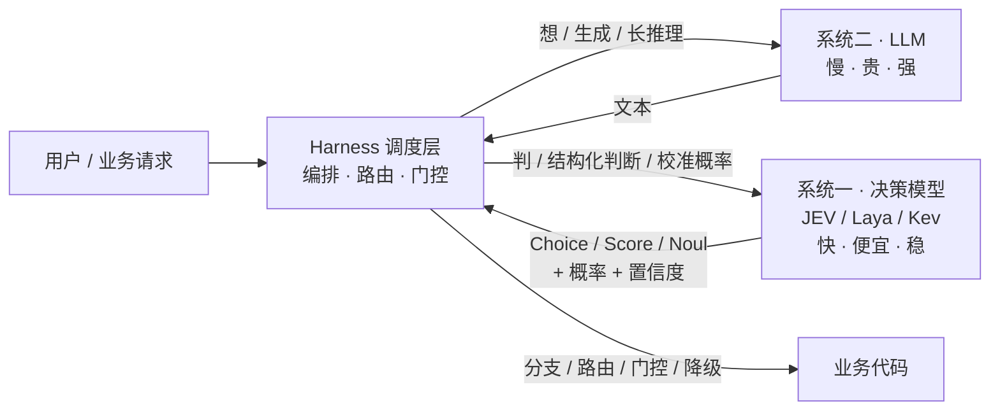

> **自绘图 1 说明**：一个分层方框图。顶部是请求入口，中间是 Harness 调度层，向下分出两条支路——左支路连「系统二 LLM（慢/贵/强）」，右支路连「系统一决策模型（快/便宜/稳）」，两条支路回流到 Harness，再输出到业务代码。强调「分工而非替代」。

### 1.2 核心定位：Decisions, not strings

#### 1.2.1 与传统 LLM 的本质区别

传统 LLM **逐 token 生成自由文本**，应用拿到文本还得自己 parse、校验、兜底；决策模型**不生成任何文本**，直接返回「类型化决策 + 概率 + 置信度」，程序可直接 `if/else`。

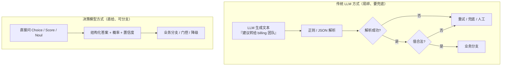

> **自绘图 2 说明**：左右两条泳道对比。左侧 LLM 链路有「解析→校验→失败兜底」多个脆弱节点；右侧决策模型链路只有「提问→结构化答案→分支」三步。

LLM 当判断器的四个痛点：① **格式不稳健**（偶尔不输出合法 JSON）；② **概率不可信**（说 90% 把握，真实可能只有 60%，无法做阈值门控）；③ **成本 / 延迟不划算**（为一个 bool 付几百输出 token 的钱与解码时间）；④ **无法并行**（问 13 个问题得调 13 次，state 重复传）。决策模型用「类型化输出 + 校准概率 + 输出免费 / 单次前向 + 一次多问并行」逐一对应解决。

#### 1.2.2 三个原语（primitives）

决策模型不是「一个分类 API」，而是三种**可组合**的判断原语。

**① Noul（是非）** —— 对一条陈述返回 0~1 的 **yes 概率**。接近 1 强 yes、接近 0 强 no、**接近 0.5 表示「拿不准」（最重要的信号，不是 bug）**。**无独立 confidence 字段**，概率本身就是信号。响应样例：`{"refund": {"type": "noul", "noul": 0.93}}`。
> 踩坑：把 `noul=0.5` 当「no」是错的，正确做法是转人工 / 上 LLM。

**② Choice（从候选集选一个）** —— 从你给定的候选集（**≤255 项**）选一个，返回「选中项 + 每项概率分布 + confidence」。用于无序类目 / 归属（分给哪个团队、归到哪个标准菜名、路由到哪条召回链路）。**强烈建议保留 `other` 兜底项**，让模型在「都不是」时有处可说，而不是硬选一个错的。
```json
{"department": {"type": "choice", "choice": "billing",
  "probabilities": {"billing": 0.82, "tech": 0.11, "sales": 0.04, "other": 0.03},
  "confidence": 0.82}}
```
> **高基数技巧**：候选超过几十项时用「两阶段」——先独立给每个选项打分（score / 向量 / BM25 粗召回），再在 top-k 里做显式 choice，避免「255 选 1 一次性 softmax 被稀释」。完整可运行示例见 `code_doubao/10_high_cardinality.py`。

**③ Score（放到有序量表）** —— 把状态放到 **2~10 级**有序量表，返回「概率加权分数（**可落在两级之间**，如 2.7）+ 分布 + confidence」。用于有语义梯度的判断：严重度、紧急度、相关度、线索质量。
```json
{"urgency": {"type": "score", "score": 3.4,
  "distribution": {"3": 0.6, "4": 0.3, "2": 0.1}, "confidence": 0.9}}
```

**怎么选原语**：

| 你的判断长什么样 | 用哪个原语 | 理由 |
| --- | --- | --- |
| 「是 / 否」「成立 / 不成立」 | **Noul** | 二值概率，0.5 即「不确定」 |
| 「从已知 N 个选项里挑一个」 | **Choice**（记得加 `other`） | 无序类目、归属 |
| 「程度如何」「分几档」 | **Score** | 保留连续梯度 |
| 「从海量未知选项里挑」 | 两阶段：先打分 / 召回，再 top-k Choice | 规避 255 上限被稀释 |
| 「要写一段话解释」 | 别用决策模型，用 LLM | 决策模型不生成文本 |

#### 1.2.3 一个端到端例子（客服工单，一次调用三原语并行）

请求（state 只传一次，三个问题并行）：

```json
{
  "state": "用户说：我被重复扣款了，请退款。这是本月第二次发生。",
  "questions": {
    "refund":     {"type": "noul",   "instructions": "用户是否要求退款？"},
    "department": {"type": "choice", "instructions": "该分给哪个团队？",
                   "criteria": {"billing": "账单/退款/扣款", "tech": "技术故障",
                                "sales": "销售", "other": "其他"}},
    "urgency":    {"type": "score",  "instructions": "紧急程度（1-5）？",
                   "criteria": ["不急", "一般", "较急", "紧急", "非常紧急"]}
  }
}
```

业务代码直接分支：

```python
if refund.noul > 0.9 and department.choice == "billing" and urgency.score >= 3:
    auto_issue_refund()        # 高置信 + 明确意图 + 紧急 → 自动退款
elif refund.noul < 0.1:
    close_ticket()             # 不是退款 → 关单
else:
    route_to_human(department) # 中间带 → 转人工，不瞎猜
```

> 📎 **可运行代码**：三原语最小示例 [`code_doubao/01_primitives.py`](code_doubao/01_primitives.py)；通用客户端（JEV 云 / 本地 Laya / 离线 Mock 三后端同一套代码）[`code_doubao/systemone_client.py`](code_doubao/systemone_client.py)。无 Key 时直接 `python 01_primitives.py` 即可看到完整结构化输出。

### 1.3 技术原理（工程师最关心的部分）

#### 1.3.1 非自回归（non-autoregressive）

自回归 LLM 生成「这是退款工单」要逐 token 采样多步，每步依赖前面的 KV cache，速度受解码步数限制；决策模型**不做 token 生成，单次前向传播直接产出所有结构化值**（所有候选 logits、所有问题答案）。省掉解码 N 步，输出不按 token 计费；代价是不能生成自由文本——但判断本不需要。

#### 1.3.2 RLCD：面向校准决策的强化学习

这是最该被工程师理解的一点，它回答了「为什么决策模型的概率**可以用**，而 LLM 的概率不可信」。

- **校准（calibration）**：模型输出 0.9 时，真实正确率就约 90%。只有校准良好，你才敢写 `if p > 0.9: 自动处理`。
- **LLM 为什么不校准**：训练目标是「下一 token 似然」，从来不是「概率要反映真实正确率」，结果普遍**过度自信**，且概率随 prompt 剧烈波动。
- **RLCD（Reinforcement Learning for Calibrated Decisions）**：把「校准概率」作为训练目标。奖励来源（人类偏好 / 可验证结果 / 合成评判 / 生产日志）与训练目标（受约束决策 + 校准分布）是**两个正交维度**，RLHF、RLVR 的奖励都可以喂给 RLCD，二者不是互斥类别。

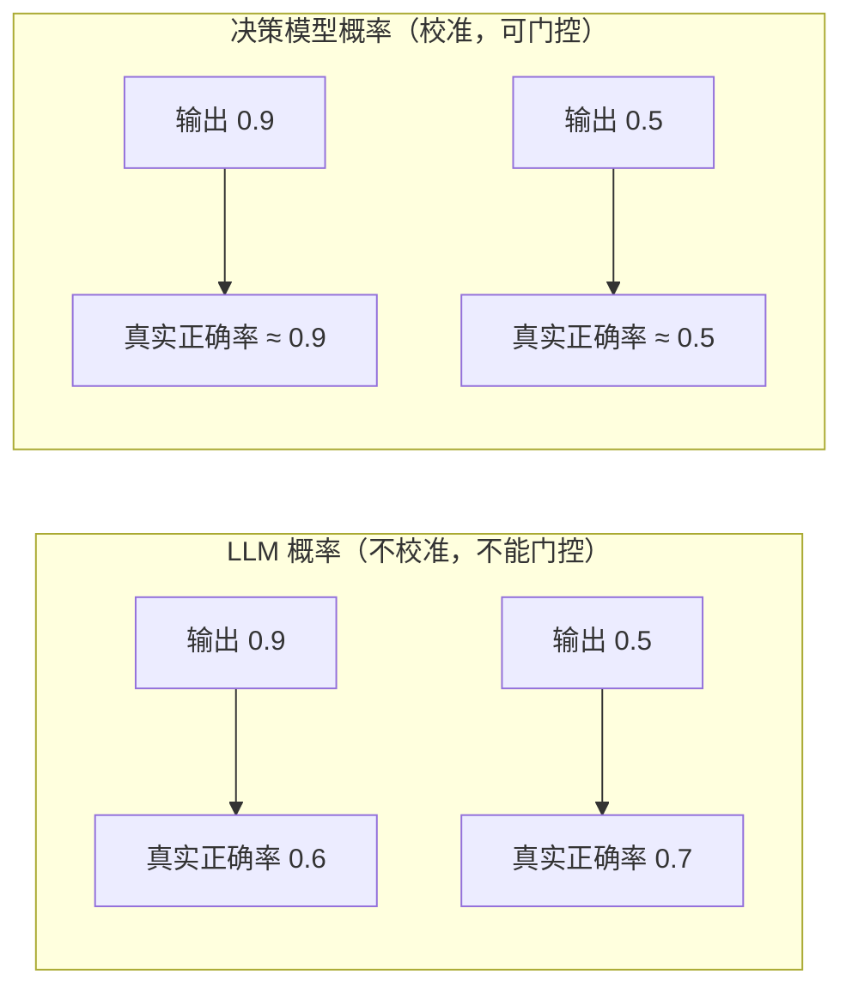

> **自绘图 3 说明**：两组「预测概率 → 真实正确率」对照。左组箭头错位（脱节），右组箭头一一对应。真实的可靠性曲线见 `images/calibration_reliability.png`（由 `code_doubao/15_eval.py` 生成）。

#### 1.3.3 硬件感知并行采样（一次前向给所有候选打分）

这是「批量并行省成本」的工程核心，四件成熟技术的组合：

- **序列打包（packing）**：把「同一 state + 多个问题 + 多个候选」拼成一批序列，共享 state 前缀；
- **树状注意力掩码（tree attention mask）**：保证问题之间、候选之间互不串扰，但都能看到公共 state；
- **决策头（decision head）**：在 backbone 上加轻量 head，把隐藏状态映射成每个问题 / 选项的 logits；
- **schema 解码**：按类型化 schema 直接还原成 choice / score / noul 结构。

结果是**一次前向**同时给「是否退款」「分给哪个团队（含每队概率）」「紧急度几分」全部打分，而不是 13 次独立前向。

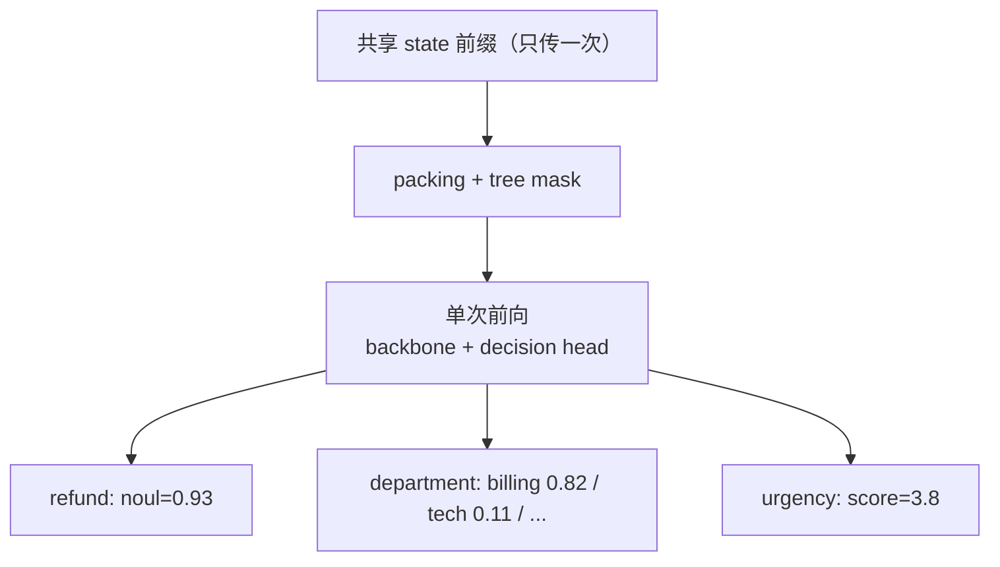

> **自绘图 4 说明**：一个共享 state 前缀经 packing + mask 进入单次前向，末端扇形分出多个结构化答案。

#### 1.3.4 社区对「架构创新」的冷静解构（批判性视角）

- 拆开看，JEV = **RLCD + 决策头 + 类型化 schema + 序列打包 + 树状注意力掩码**，每一项都是成熟组件。
- 所谓「parallel sampler」是上述工程的**产品化组合**，并非新的注意力算子或采样算法；发布稿未给出新算子、复杂度证明或隔离创新点的消融实验。
- **公允结论**：JEV 的价值更像「组合创新 + 产品化 + 校准训练」，而非底层架构突破。这反而是好消息——它**可被复现、可被开源追平**（第二部分会看到两周内即出现大量跟进），我们不会被一家闭源公司锁死。

#### 1.3.5 输入约束与定价

- **输入**：文本、JSON 对象、文本数组；**不支持图像 / 音频 / 视频**。多模态需先用 OCR / ASR / 视觉模型转成文本或结构化观察（开源 Intern-Decision 在尝试把「看懂图」与「判断」合并）。
- **定价\***：输入约 **$0.042 / 百万 token，输出 token 免费**（非自回归、无输出计费）——对高频判断极友好，你只付 state 的钱。

### 1.4 为什么快、为什么便宜（性能数据 + 成本测算）\*

> 本节带 \* 数字均为厂商自报上限，非典型生产值。

- 分类决策任务比前沿 LLM 快约 **194~200×**，成本最低约 **445×**（供应商上限）。
- 单次端到端延迟约 **70~500 ms**（官方西海岸服务器实测），官方口径单次约 100 ms 量级。
- **批量并行是性价比关键**：13 个问题一次调用 vs 顺序 13 次，成本约降 **12.2×**、速度约快 **10×**（state 只传一次）。

**成本对比（每 1000 次决策、各 2000 输入 token，建模口径）**：JEV ≈ **$0.084**；GPT-6 Luna 短标签 ≈ **$0.215**；带约 500 推理 token ≈ **$0.465**——同样判断，JEV 比「带推理 LLM」便宜约 5.5×。

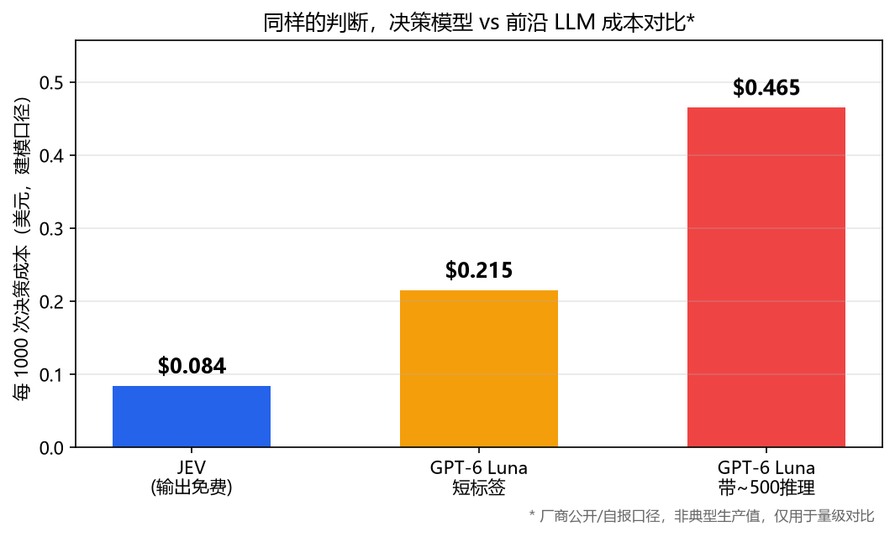

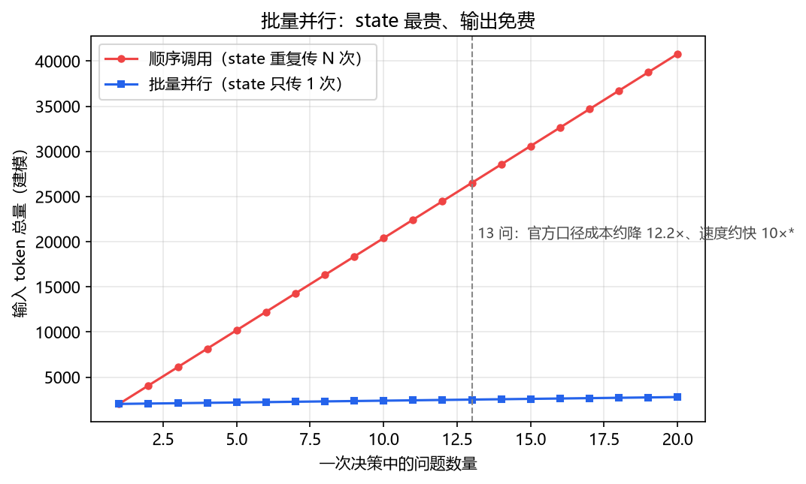

> 上面两张图由 [`code_doubao/make_figures.py`](code_doubao/make_figures.py) 生成（`python make_figures.py`），原始单价 / 假设在脚本顶部，可按最新报价修改。

**什么时候决策模型反而不划算（诚实讨论）**：① 判断量很小（每天几百次），工程改造不值；② 高度定制、已有标注数据且追求极致延迟，现有 BERT/GLiNER 可能更准更省（见 2.6）；③ 需要开放生成 / 长推理，决策模型根本不做。

> 📎 **可运行代码**：成本 / 速度测算 [`code_doubao/03_cost_model.py`](code_doubao/03_cost_model.py)；批量 vs 顺序的 token 与耗时对比 [`code_doubao/02_batch_parallel.py`](code_doubao/02_batch_parallel.py)。

### 1.5 JEV 的边界（工程师必须知道，避免误用）

> 决策模型被误用的代价，远高于不用它。

**做不了的（都应交给代码）**：

| 失败类型 | 例子 | 正确做法 |
| --- | --- | --- |
| 精确算术 / 计数 | 「列表里有几个 item？」数错 | 计数交给代码 |
| 跨日期有序比较 | 「A 日期是否晚于 B？」（跨月 / 跨年易错） | 用 `datetime` 比较 |
| 数值邻近 | 「19.99 和 20.01 是否接近？」不稳 | 用阈值代码 |
| 双重否定 | 「我不不需要退款」Noul 易翻车 | 关键路径保留 human-in-the-loop |
| 长上下文「腐烂」 | 整本手册塞进 state，无关信息稀释判断 | 精简 state，只留决策相关内容 |

**CJK（中文）准确率偏低 —— 对我们尤其关键**：TypeSafe 自述在中文等非英文语言上准确率更低（训练数据以英文为主）。**中文场景优先测开源中文基座**（Kev / StartLux / Laya-multilingual / Clef / Strands / Microsoft-Decision-1，几乎都跑在 Qwen 系上），不要把原版 JEV 的英文成绩平移到中文任务。

**置信度 ≠ 正确性；格式正确 ≠ 语义正确**：JEV 保证「从你给的 A/B/C 里返回一个合法候选」，但**完全可能选错 B**——它不会越界，但会选错。严谨表述是：「决策模型不会给出候选范围之外的结果，同时提供一个可被程序控制的概率信号」。这个信号必须配合**门控 + 降级 + 人工兜底**（见 3.3、3.6）。

**不适用**：开放文本生成、长推理链、需要「把想法说出来」的任务——留给系统二。

---

## 第二部分：开源生态

### 2.1 为什么需要开源替代

JEV **闭源、无公开权重、不能本地部署、仅托管 API，且对中国大陆地区尚未开放**——意味着数据出境、无法私有化、无法微调、受供应商可用性约束。对涉及商户数据（菜品匹配）、用户 query（搜索）的场景，闭源 API 基本不能直接上生产。但好消息是：JEV 发布后约**两周内行业集体跟进**，决策模型从「一家首发」迅速走到「群战」。

### 2.2 闭源 / 托管同类（含时间线）

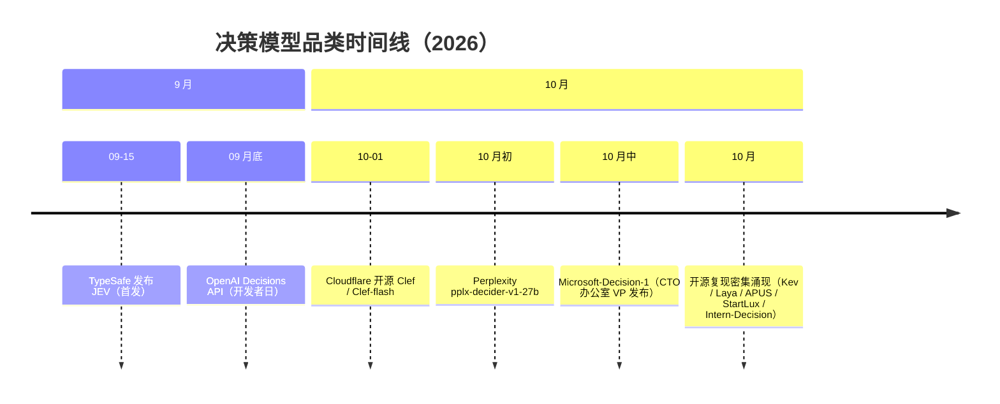

> **自绘图 5 说明**：一条从 9 月中到 10 月中的横向时间线，标注各厂商发布节点，直观体现「两周群战」。

- **OpenAI Decisions API**：开发者日推出，基于自家小模型，约两周做出——连 OpenAI 都把「决策」当作独立能力层。
- **Perplexity pplx-decider-v1-27b**：Qwen3.8-27B 微调，Apache 2.0，**HuggingFace 公开权重**；约 $0.04 / 百万输入；自报 11 基准面板 85.71% vs JEV 84.51%（自报面板，审慎引用）。
- **Cloudflare Clef / Clef-flash**（2026-10-01 开源）：Qwen 后训练，Apache 2.0；Clef 中位 ~209 ms / $0.24/M，Clef-flash ~39 ms / $0.09/M；65k token 上下文，可走 Workers AI。
- **AWS Strands Decider 2B**：Qwen 2B 底座，把 next-word 头换成约百万参数 pointer head；中位 ~115 ms（RTX 3090）/ ~153 ms（M3）；**开源权重 + 训练数据 + 脚本**（Apache 2.0），本地零边际成本，最「可复现训练」。
- **Microsoft-Decision-1**（2026-10）：Qwen3.5-9B 后训练，上架 Foundry + OpenRouter；官方称 36 基准 15 万题盲测准确率最高、比 GPT-6 Sol 快约 35×、8 类扰动仅 1.3% 翻转。闭源托管、走网关，是大厂正式下场的标志（Datawhale cookbook 知识库 #39 全译）。

> 🔑 **关键观察（务必讲）**：这一轮决策模型的「躯干」大量是**中国开源基座 Qwen**——Clef、Strands、APUS、Microsoft-Decision-1 都跑在 Qwen 上。闭源 JEV 留下的「本地化 / 数据不出域」缺口，正好被开源中文基座补上，对我们是利好。

### 2.3 开源 / 可本地部署清单

> 注意：这些项目大多**复现接口 / 范式，并非复现 JEV 未公开的模型与训练**；切基座后不能把原版成绩平移，要逐一核对基座、限制与测试方法。

| 项目 | 基座 / 路线 | 协议 | 规模 | 特点 / 适用 |
| --- | --- | --- | --- | --- |
| **Kev** (jaredpalmer/kev) | Qwen3.5 | Apache 2.0（可商用） | 0.8B/4B/9B/27B | 兼容 `/v1/systemone`；0.8B 无 GPU 可跑；Modal 一键 HTTPS；生产建议 4B 起 |
| **OpenJev** (razorback16/openjev) | DiffusionGemma + vLLM | 开源 | — | 同时提供文本生成接口；openjev-sglang：Qwen + SGLang（B200 示例） |
| **APUS fast-browser-use** | Qwen3.5-9B | MIT | 单模型 | 首批开源复现；单 token logits 决策 + KV-Cache 广播 + 并发批量；浏览器自动化；离线运行 |
| **Laya / Laya-MLX / Laya-ONNX** | 双向编码器 | 开源（Apache-2.0） | 322~421M | Apple Silicon / AMD / x86 CPU；毫秒级、~420MB；多语言含中文；可微调（**本文重点，见 2.4**） |
| **NanoJev** | 0.6B 并行决策 | 开源 | 0.6B | 附训练资料，适合研究小模型如何组织多项决策 |
| **SemIf / jeff / simple-jev** | 各自开放模型 | 开源 | jeff 400M（GLiFormer） | SemIf 复现接口模式；simple-jev 用开放模型分数构造分类 / 评分 |
| **Intern-Decision**（上海 AI 实验室） | 多模态 | 开源 | 0.8B/2B/4B | 看懂图像 / 界面再决策；官方称比 JEV 快 2~3× |
| **StartLux-Decision**（陈大年 / 原点星辉） | Qwen 后训练 | 开源 | 0.8B~27B（五档） | 配齐量化；4B Q4 ~2.71GB 与原始权重一致率 98.3%；27B 自测超 JEV（自测需谨慎） |

工程师视角速读：**Kev** 最像「JEV 开源平替」，接口兼容、可商用；**APUS** 的「单 token logits + KV-Cache 广播 + 并发批量」适合 computer-use 动作选择；**Laya** 体量小、多语言、可微调，是「中文 + 私有化 + 能自己训」的最优选；**NanoJev** 适合研究而非生产；**Intern-Decision** 唯一把多模态与判断合一；**StartLux** 尺寸档位 / 量化最全，便于按机器选型。

### 2.4 ★ 重点深讲：Laya（部署 + 微调，算法工程师日常可用）

#### 2.4.1 为什么是它

Convai Innovations 出品（Apache-2.0），与 JEV 同范式（choice/score/noul、校准概率、单次前向、无文本生成）；**提供含中文的多语言 checkpoint**；兼容 `/v1/systemone`，可与现有 JEV 请求无缝替换；体量小（322~421M）、本地毫秒级；**附带可复现微调配方**，能把通用 Laya 变成「我们的」判断模型。

#### 2.4.2 架构（一页纸）

双向编码器（英文 ModernBERT-large 421M / 多语言 mmBERT-base 322M）→ 决策 Transformer + scoring/action heads → 校准概率输出。判断不需要「因果掩码下的自回归生成」，而要「看完整个 state 给判断」，双向注意力（像 BERT）天然更合适且更快；无自回归解码，带 **fitted temperature calibration（温度拟合校准）**。

#### 2.4.3 三个官方 checkpoint（HuggingFace）

| checkpoint | 基座 | 规模 | 上下文 | 适用 |
| --- | --- | --- | --- | --- |
| `convaiinnovations/laya` | ModernBERT-large | 421M | 512 | 英文 |
| `convaiinnovations/laya-multilingual` | mmBERT-base | 322M | 1024 | **多语言（含中文）← 我们优先** |
| `convaiinnovations/laya-typed-decisions` | ModernBERT-large | 421M | 1024 | typed-decisions 工作流 |
| MLX FP16：`aac6fef/laya-mlx` 等 | — | — | — | Apple Silicon 原生 |

#### 2.4.4 四种部署方式（按场景挑）

1. **CLI 最快试用**：`pip install laya` → `laya "我被重复扣款了，请退款。"`。用于验证范式、本地手测。
2. **HTTP 服务（JEV 兼容，推荐接入现有链路）**：`pip install "laya[serve]"` → `LAYA_DEVICE=cuda LAYA_PRELOAD=1 laya-serve`，起 FastAPI 暴露 `POST /v1/systemone`，与 JEV 同格式；**把请求地址从 JEV 云换成本地地址即可，业务代码零改造**。
3. **Docker（CPU + CUDA 服务化）**：`docker compose -f compose.yaml -f compose.http.yaml up --build laya-serve`，适合生产容器编排。
4. **Laya-MLX（Apple Silicon 原生、无 PyTorch）**：`pip install laya-mlx`，内存 <1GB，M 系列毫秒级（M3 Max P50 英文 13.4ms / 多语言 7.4ms；batch-50 多语言 395 q/s），适合笔记本本地开发。

Python 调用（工程师可直接抄）：

```python
import laya_mlx as laya
agent = laya.load("aac6fef/laya-multilingual-mlx", dtype="float16")
result = agent.predict("I was billed twice. Please refund the duplicate today.", {
    "department": {"type": "choice", "instructions": "Which team should handle this?",
                   "criteria": {"billing": "invoices, payments, refunds",
                                "technical": "bugs and outages", "sales": "new purchases"}},
    "urgency":    {"type": "score", "instructions": "How urgent?",
                   "criteria": ["not urgent", "soon", "critical"]},
    "refund":     {"type": "noul", "instructions": "Does the customer ask for money back?"},
})
print(result["answers"])     # 与 JEV 同 schema
```

进阶参数：`device="gpu"|"cpu"`、`batch_size`（默认 16，超出分块）、`compile=True` + `cache_prompts=True`（重复负载前缀缓存，上限 128 问题）；多模型可用 `Router(dtype="float16", max_loaded=2)` + `router.predict(state, questions, task="typed_decisions")`。

> 📎 **可运行代码**：本地推理（MLX / PyTorch / Mock 三回退）[`code_doubao/04_laya_local.py`](code_doubao/04_laya_local.py)；FastAPI 兼容服务 [`code_doubao/05_laya_serve.py`](code_doubao/05_laya_serve.py)。

#### 2.4.5 微调：把 Laya 变成「我们的」判断模型

端到端数据流：


> **自绘图 6 说明**：从左到右的流水线五段：数据集→RLCD 训练→温度拟合→评估（画校准曲线）→推 Hub / 起服务。

- 官方提供 **Kaggle Notebook**，免费 2×T4 约 **4~5 小时**跑完整流程：构建决策数据集 → RLCD 训练 → 温度拟合 → 评估 → 推送 Hub。RLCD 训练代码在 upstream 训练仓库，`laya-mlx` 只做推理 / 转换。
- **数据长什么样**：每行 `{state, questions, answers}`。菜品判等用 noul、标准菜名归属用 choice（带 `other`）、相似度分级用 score。建议 Noul 用**软标签**（确定为真给 0.95~0.99，模棱两可给 0.4~0.6），帮助模型学出「不确定」。
- **校准坑（务必避免）**：v0.3.5 起把拟合温度 **clamp 到 [0.5, 5.0]**；若不 clamp，某个分桶原始温度（如 0.1006）会把 logits 锐化约 10×，把「抛硬币」报成「近乎确定」，门控形同虚设。**微调后必须在自己数据上画可靠性曲线、报告 ECE/Brier**，换基座 / 数据漂移后重做温度拟合与阈值选择。

> 📎 **可运行代码**：数据集构造（产出 `dish_match.jsonl` / `search_relevance.jsonl`）[`code_doubao/06_finetune_laya.py`](code_doubao/06_finetune_laya.py)；完整上手指南（Kaggle 流程、软标签、校准、灰度）[`code_doubao/06_finetune_laya.md`](code_doubao/06_finetune_laya.md)。

### 2.5 生态索引与中文学习入口

**① Awesome Jev（[fatwang2/awesome-jev](https://github.com/fatwang2/awesome-jev)，MIT，独立整理）**——生态「总目录」，与日常最相关的工具：

- **`jevcal`**：别瞎猜置信度阈值——在你的数据上测模型、选满足准确率目标的阈值、算还需多少流量走 LLM、模型更新悄悄破坏时让 **CI 失败**（直接对应我们的阈值工程）。
- **`jevfire`**：把多个有限选择字段批量并行过 vLLM，复用共享指令 / 上下文前缀。
- **`jevmlx`**：给定 schema，一次前向给每个字段算概率、自行拼出合法 JSON（valid by construction）。
- 兼容层：`LitJev`、`WaterSheep`、`openjev`、`Open-Jev`、`Laya`（均兼容 `/v1/systemone`）。
- 安全 / 合规评测：`jev-sec-bench`（提示注入 / 漏洞代码）、`jev-secret-detection`（密令识别）、`jev-spam-eval`（零样本分类 + 上下文增强）。
- Coding Agent：`jev-mcp`、`jev-router`、`pi-jev`、`foreman`、`jev-rules`、`skillbox`（MCP 化判断、按 turn 路由、工具前语义防火墙）。

**② Datawhale jev-cookbook（[datawhalechina/jev-cookbook](https://github.com/datawhalechina/jev-cookbook)，CC BY-NC-SA 4.0，[在线阅读](https://datawhalechina.github.io/jev-cookbook/)）**——最适合中文工程师的系统入口：11 章可运行中文教程 + 官方文档全站中译 + 40+ 条社区知识库 + 18 篇官方实战配方 + 12 个可运行应用，**无需 API Key 可离线跑**（`./setup_env.sh` + `JEV_RUN_MODE=offline`）。

- **第一部分 入门**：认识 Jev / 核心概念 5 册 / 架构模式（推测性扇出 · 置信度门控 · 复合评分 · 意图路由）。
- **第二部分 实战**：**18 篇配方**（重排序 / 语义搜索 / 函数调用 / 引用核查 / 防护栏，几乎就是搜索 / NLP 日常模板）；语音 3D 智能家居；**模型评测**（Laya vs Jev 四维基准与「无重试无回退、预算记账」纪律）；12 个应用。
- **第三部分 研究与生态**：前沿（Jev-Mem 记忆 + JevHarness 控制流）；Agent 集成（Pi 工具调用 gate + DSH 决策协作）；**本地模型 Laya RLCD 微调全流程**；知识库。

### 2.6 决策模型 vs BERT / DeBERTa / GLiNER

| 维度 | 传统分类器（BERT / GLiNER） | 决策模型（JEV / Laya） |
| --- | --- | --- |
| 训练 | 每类目单任务管线、持续标注 | 零样本迁移、问题空间可变 |
| 多任务 | 一个模型一件事 | 同一模型多任务复用 |
| 概率 | GLiNER 等**无校准保证** | 校准概率（可门控） |
| 延迟 / 本地 | 低延迟、可本地 | 更低（非自回归）、可本地（开源） |
| 泛化 | 只懂训练分布 | 基础模型泛化 |
| 维护 | 数据漂移要重训监控 | 换基座 / 微调即可 |

**结论（讲透）**：决策模型**不是替代 BERT**，而是把「判断」做成可复用、可校准、可阈值化控制的**基础设施层**。高频固定类目 + 有标注 + 极致延迟的场景，现有小模型仍能打，**先别急着换**；决策模型的增量价值在零样本泛化、问题空间多变、要校准概率做自动分支。

### 2.7 评测基准：怎么选、怎么评估（别被榜单带偏）

- **JevBench**（Benchmark Heaven，v1.5.5）：智能 / 校准 / 速度 / 成本 **4 轴等权**；109 系统、1624 决策 / 系统、720 密封题防泄露。v1.5.5 中 JEV 综合 #3（72.1），前两名为 Gemma-4-12B 社区微调；GPT-6 Luna 智能 96.2 / 校准 95.6 远高于 JEV，却因速度 / 成本轴崩只排 #37。
- **Decision Index**（HuggingFace，multimodalart，0.2.1）：43 基准、120340 请求 / 系统，单卡 RTX PRO 6000，单独报校准（ECE）。快照中 JEV 1.13 居首（57.91），但身后开源 27B 仅差半分；JEV 校准 ECE 0.074 并非最优（Jebadiah 0.014、pplx-decider 0.018 更好）。
- **其他**：S1MB、sysone-bench（密封 manifest 同输入对比）、Cua-Bench-S1（computer-use 动作选择）、Bespoke Nimble、StartLux eval 套件（可 `--endpoint` 拉通评测任意 `/v1/systemone` 服务）。
- **关键认知**：厂商榜单是「选出来的上限」而非典型值。**决策模型买的不是「比最强 LLM 更聪明」，而是「够用的判断 + 极低代价与延迟」**。评估自己的场景，永远在自己的数据上做 A/B，而不是引用榜单。

---

## 第三部分：对我们组算法工程师日常有用的东西

> 这一段把前两部分落到日常：心智模型 → 可套场景 → 工程接入 → 评测纪律 → 选型 → 风险 → 落地清单。cookbook 18 篇配方是现成模板，awesome-jev 工具是现成工程件，组内 PPT《Jev：10 个使用场景》提供十个实测样板。

### 3.1 心智模型：把「判断」从「生成」里剥出来

**核心动作**：把 pipeline 里所有「先让 LLM 生成文本、再 parse 成 bool / 类目 / 分数」的环节，改成「直接问决策模型拿结构化判断」。

- **改造前**：`query → LLM(输出文本) → 正则解析 → 校验 → 分支`（贵、慢、易碎、概率不可信）。
- **改造后**：`query → 决策模型(Noul/Score/Choice) → 分支 / 门控 / 降级`（便宜、快、校准概率）。

**收益**：输出免费 + 非自回归（便宜快）、可程序化分支、可阈值化控制、带校准概率。**代价**：放弃自由文本与长推理——而这正是它该待的位置（高频、固定形态的判断）。

### 3.2 直接可套的场景

#### 3.2.1 搜索 / NLP（最现成，cookbook 第 4 章即模板）

| 子任务 | 原语 | 对应配方 / 场景 |
| --- | --- | --- |
| 相关性判定 / 重排序 | Noul / Score / Choice | 配方「重排序」「语义搜索」；PPT 场景 07 |
| 语义路由（路由到召回链路 / 模型） | Choice | 架构模式「意图路由」；PPT 场景 04 |
| 蕴含 / NLI（两句是否矛盾 / 蕴含） | Noul | — |
| 防护栏 / 安全门 | Noul + 阈值 | 配方「防护栏」；PPT 场景 09 |
| 函数 / 工具调用 gate | Choice | 配方「函数调用」「引用核查」 |
| 上下文压缩（逐条判断历史是否保留） | Noul | PPT 场景 05 |

搜索相关性判定是**最该先试的 POC**：高频、形态固定、对延迟敏感、且已有标注数据可建评测集。

> 📎 **可运行代码**：相关性 + 重排序过滤层 [`code_doubao/09_search_rerank.py`](code_doubao/09_search_rerank.py)；上下文压缩 [`code_doubao/12_context_compression.py`](code_doubao/12_context_compression.py)；模型路由 + 成本账本 [`code_doubao/13_model_router.py`](code_doubao/13_model_router.py)。

#### 3.2.2 菜品匹配（天然适配，给出可落地完整方案）

**① 问题拆解（三原语映射）**

- `is A==B`（同一道菜的不同写法 / 别名 / 错别字，如「宫爆鸡丁」vs「宫保鸡丁」、西语 / 葡语 SKU 归一）→ **Noul**，0.5 附近转人工 / 上 LLM。
- 候选标准菜名归属（「鱼香茄子」归到标准库哪条）→ **Choice**（≤255 项标准库 + `other`）；标准库更大时走**两阶段**（见 `10_high_cardinality.py`）。
- 相似度 / 置信分级（「微辣宫保鸡丁」与「宫保鸡丁」多接近）→ **Score**（可落两级之间）。

**② 置信度驱动分流**

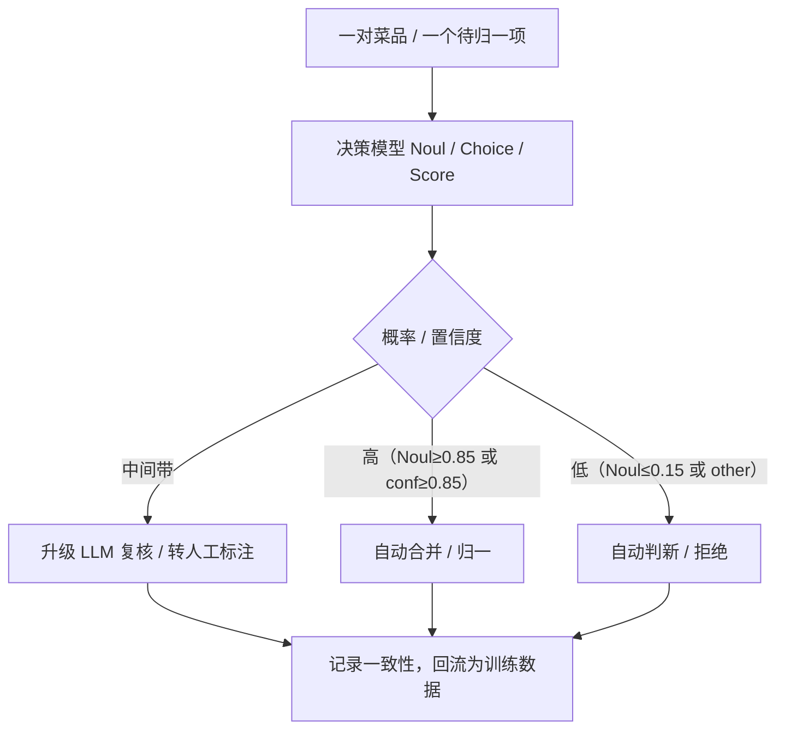

> **自绘图 7 说明**：菜品匹配三档分流。高置信自动、低置信判新、中间带升级，所有结果记录并回流，形成数据闭环。

**③ 数据闭环**：把历史「用户写法 → 标准菜名」标注沉淀为决策数据集，在 `laya-multilingual` 上 RLCD 微调（见 2.4.5），本地服务化后更准、数据不出域。

**④ 灰度上线**：shadow（与现有结果并跑比对一致性）→ canary（小流量让高置信自动合并，监控准确率 / 复核率 / ECE）→ enforce（高置信自动、中低置信降级，全量）。

> 📎 **可运行代码**：判等 / 归属 / 分级 + 置信分流 [`code_doubao/08_dish_matching.py`](code_doubao/08_dish_matching.py)；大标准库两阶段归属 [`code_doubao/10_high_cardinality.py`](code_doubao/10_high_cardinality.py)。离线 Mock 已能演示「错别字 / 别名自动合并、不确定项升级」的完整分流。

#### 3.2.3 十个社区实测场景（直接取自组内 PPT）

PPT《Jev：10 个使用场景》把场景讲得很实，下表汇总「原语 + 解决什么 + 关键做法 / 数字」，全部有可运行实现：

| # | 场景 | 原语 | 解决什么 | 关键做法 / 实测数字* |
| --- | --- | --- | --- | --- |
| 01 | 收件箱自动分类 | Choice | 邮件分文件夹 | 文件夹=选项，不确定留人工；500 封约 $0.035 |
| 02 | 关键词意图归类 | Choice | 搜索意图识别 | 逐行标 informational / commercial / transactional；1000 篇论文分 24 类约 $0.08、单条约 0.25s |
| 03 | 销售线索评分 | Score + Noul | 线索质量 | 弱 / 中 / 强 + 话术匹配度；700 条 40 秒约 $0.09；「不匹配」红列最有价值 |
| 04 | 模型 / 工具路由 | Choice | 成本优化 | 便宜 / 均衡 / 旗舰自动选；12 条中 9 条不需旗舰，成本约降 70% |
| 05 | 编码 Agent 上下文压缩 | Noul | 省 token | 逐条判工具记录留 / 删；记忆 13000→2756 token，约 $0.003 |
| 06 | 浏览器操作选择 | Choice | computer-use | 每步选「动作 + 元素」，观察新状态后再要下一步；Google Flights 约 7s、约 $0.0039 |
| 07 | 搜索结果重排序 | Choice / Score | RAG 质量 | RAG 前先过滤无关 / 过时 / 冲突文档 |
| 08 | 发布质量红绿灯 | Noul×3 | 内容质量门控 | 是否答意图 / 有无无来源断言 / 内链是否合理，绿黄红分流 |
| 09 | 智能体护栏 | Noul | 安全 | 输入 / 输出风险评估，危险操作执行前阻断 |
| 10 | 内容审核 / 工单分流 | Choice / Score | 审核效率 | 评论 / 工单秒级判类别 + 紧急度 + 是否转人工 |

> 表中数字为原作者实测 / 宣传上限，引用请注明。**PPT 最该记住的一句结论**：决策模型最有用的不是「它多快」，而是「**它会告诉你哪些它没把握**」——把不确定的那列交还人类，而不是悄悄猜错。

> 📎 **可运行代码**：十个场景综合演示 [`code_doubao/14_ten_use_cases.py`](code_doubao/14_ten_use_cases.py)（`python 14_ten_use_cases.py` 一次跑完）；路由 / 压缩 / 重排 / 护栏另有更完整版（13、12、09、11）。

#### 3.2.4 Agent（后续方向）

- **工具安全门**：调危险工具前用 Noul 判意图 / 权限；**完成验证**：子任务是否达成用 Noul（对应 PPT 场景 09）。
- **按 turn 路由模型 / 技能**：`jev-router` / `jev-mcp` / `foreman` / `jev-rules` / `skillbox`（对应场景 04）。
- **控制流**：JevHarness（cookbook 第 8 章）把「判断」当作控制流节点——Agent 不再是「LLM 一路生成」，而是「决策模型在关键节点分支」。

> 📎 **可运行代码**：工具调用前风险门控 + 完成验证 + 危险阻断 [`code_doubao/11_agent_guardrail.py`](code_doubao/11_agent_guardrail.py)。

### 3.3 工程接入（门控 / 批量 / 阈值 / 监控，可直接抄）

**双栈策略**：线上先用 JEV / 托管 API 验证范式；生产切 Laya 本地（见 2.4）。

**置信度门控 + LLM 降级骨架**（完整可运行版见 `07_confidence_gate.py`）：

```python
def decide(client, state, question, llm_fallback, thr=0.9):
    r = client.ask(state, {"q": question})["answers"]["q"]
    if question["type"] == "noul":
        p = r["noul"]
        if p > thr:      return ("yes", p)    # 高置信自动
        if p < 1 - thr:  return ("no", 1 - p)
        return llm_fallback(state, question)  # 中间带升级，不瞎猜
    if r.get("confidence", 1) < 0.6:         # Choice/Score 阈值用 jevcal 在数据上选
        return llm_fallback(state, question)
    return (r.get("choice", r.get("score")), r.get("confidence"))
```

要点：**降级不是失败，而是「把不确定的交还更贵的系统」**——这正是决策模型性价比的来源。

- **批量并行**：一次调用塞多个问题（state 最贵、输出免费），即 `jevfire` 思路（见 `02_batch_parallel.py`）。
- **阈值工程**：用 `jevcal` 在数据上选阈值、算 LLM 流量、模型更新破坏时让 CI 失败——**阈值别拍脑袋**（见 `16_threshold_jevcal.py`）。
- **生产监控（必做）**：记录每次决策的概率 / 置信度、是否走降级、降级后 LLM 结论是否与决策模型一致；一致性骤降即模型漂移 / 数据分布变化，触发告警。

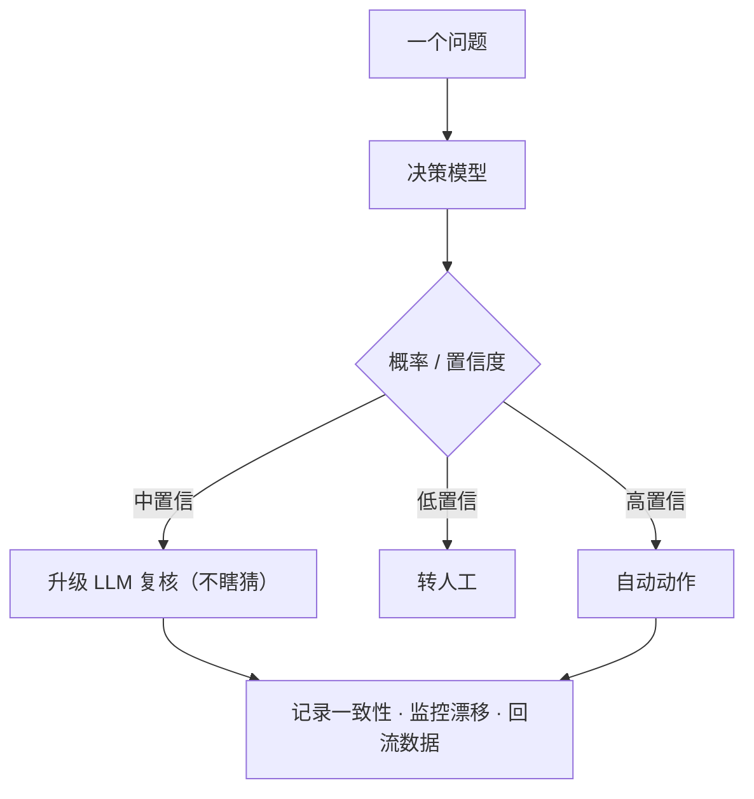

> **自绘图 8 说明**：置信度门控三分支控制流，所有分支汇入「记录 / 监控 / 数据回流」。

> 📎 **可运行代码**：门控 + 降级 [`code_doubao/07_confidence_gate.py`](code_doubao/07_confidence_gate.py)；阈值选择 + LLM 流量 + CI 守门 [`code_doubao/16_threshold_jevcal.py`](code_doubao/16_threshold_jevcal.py)。

### 3.4 评测纪律（别被厂商榜带偏）

复用 cookbook 第 6 章「诚实评测」：**无重试、无回退、预算记账**，报**四维**——

- **准确率 Accuracy**：判得对不对；
- **底线率 Baseline**：落在「模棱两可」区间、需要降级 / 转人工的比例（模型不强行自动动作的比例）；
- **Brier**：概率预测的均方误差（综合校准 + 分辨，越小越好）；
- **ECE（期望校准误差）**：分桶后「平均预测概率 vs 桶内真实正确率」的差距，越小越校准。

**关键：不只看准确率，还要看校准**——决策模型买的正是校准概率，只看准确率会误判。下图显示：两个模型准确率相近（约 0.72~0.74），但校准良好者 ECE≈0.04、过度自信者 ECE≈0.12；后者更敢自动、却把没把握说成确定，门控风险大。

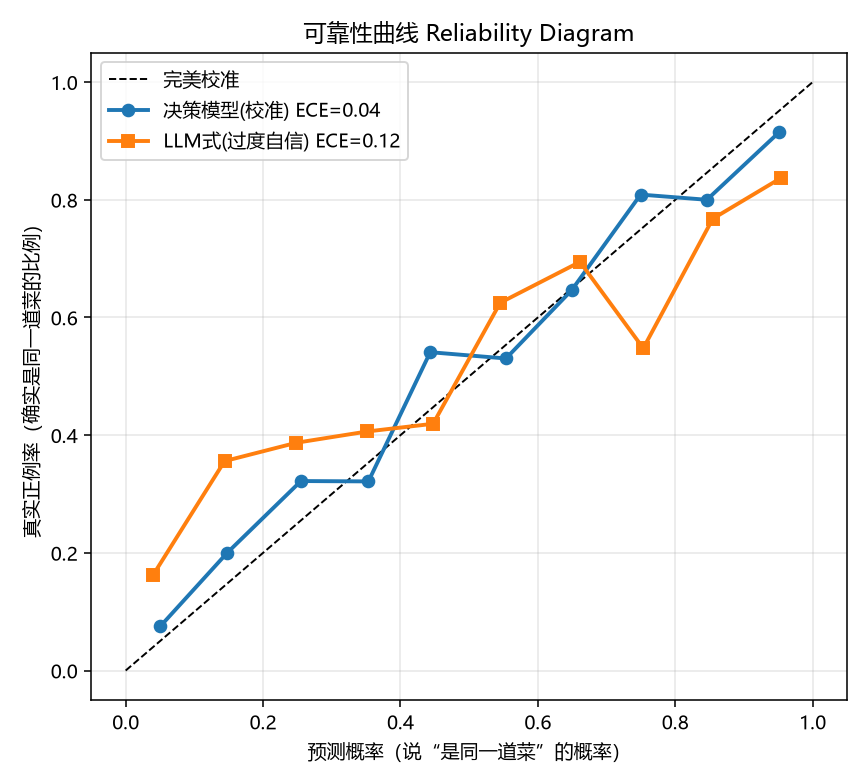

**自建中文评测集步骤**：① 从生产日志抽 N 条判断样本（如 2000 条 query–doc 对 + 人工相关标签，或菜品判等对）；② 同一份数据分别过决策模型、现有 BERT/GLiNER、LLM；③ 算四维；④ 画可靠性曲线；⑤ 用 `jevcal` 选阈值，在满足目标准确率前提下最大化自动比例、最小化 LLM 流量。

> 📎 **可运行代码**：四维指标 + 可靠性曲线（纯 numpy，含「校准 vs 过度自信」对照）[`code_doubao/15_eval.py`](code_doubao/15_eval.py)；阈值扫描 [`code_doubao/16_threshold_jevcal.py`](code_doubao/16_threshold_jevcal.py)。

### 3.5 选型决策树

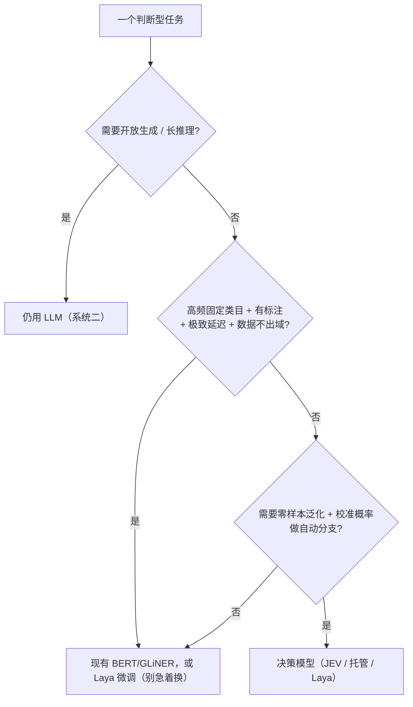

> **自绘图 9 说明**：自上而下三问的决策树——先问要不要生成，再问是否高频固定且要私有化，最后问要不要零样本 + 校准。

- 高频固定类目 + 有标注 + 极致延迟 + 数据不出域 → 现有 BERT/GLiNER 或 **Laya 微调**。
- 需零样本泛化、问题空间多变、要校准概率自动分支 → 决策模型（JEV / 托管 / Laya）。
- 开放生成 / 长推理 → 仍用 LLM。
- **中文优先 → 测 Qwen 系**（Kev / StartLux / Laya-multilingual / Clef / Strands / Microsoft-Decision-1）。

### 3.6 风险与误用（工程红线）

- **置信度 ≠ 正确性；格式正确 ≠ 语义正确**：必须门控 + 降级 + 人工兜底。反例：把 Noul=0.5 当「no」直接关单，漏掉一批真实退款——0.5 是「没把握」，应转人工。
- **CJK 偏弱**：中文场景先测开源中文基座，别直接信原版 JEV 成绩（见 1.5）。
- **长上下文「腐烂」**：state 要精简。反例：把整本帮助文档塞进 state 判「是否退款」，无关段落稀释判断，准确率掉一截。
- **闭源 JEV 对中国大陆未开放、数据出境风险**：涉及商户 / 用户数据的场景**绝不直接走闭源 API**，优先本地 / 开源（见 2.1）。
- **校准会随数据漂移**：微调 / 换基座后必须重画校准曲线、重选阈值，别沿用旧阈值。
- **别让它算数**：计数 / 比较 / 日期 / 数值邻近交给代码，决策模型只做有界判断。

### 3.7 MVP 落地清单（综合 PPT 与本文）

1. **选试验田**：挑一个「选项已知、量大、要快」的流程（菜品判等 / 搜索相关性 / 工单分类）先试，别一上来重构核心链路。
2. **写显式标准**：把判断写成清晰的 true/false 条件与候选描述，别让模型自己「猜你的标准」。
3. **设置信度阈值**：低于阈值一律交还人类，绝不自动动作——这是用好决策模型的核心；阈值用数据选（`16_threshold_jevcal.py`）。
4. **先做过滤层**：让决策模型坐在「检索 / 路由」与「大模型」之间，把难的挑出来，省钱又稳。
5. **代码算数**：计数 / 比较 / 日期交给代码，决策模型只做有界判断。
6. **四维评测 + 灰度**：准确率 / 底线 / Brier / ECE 齐报，shadow → canary → enforce。

---

## 收尾与下一步

- **一句话总结**：JEV 不是「会思考的聊天模型」，而是 Agent 架构里的「廉价高频判断层」；**系统二负责想，系统一负责判，Harness 负责调度**。
- **下一步行动**：
  1. 盘点 pipeline 里所有「判断型」LLM 调用（让 LLM 输出 bool / 类目 / 分数的地方）；
  2. 选 POC——**强烈建议菜品匹配或搜索相关性判定**；
  3. 自建中文评测集做 A/B（准确率 + 成本 + 延迟 + 校准四维齐报）；
  4. 若做 Agent，先在小接缝（工具安全门、完成验证）按 shadow → canary → enforce 推进；
  5. 私有化路径直接走 Laya-multilingual + RLCD 微调，数据不出域。
- **Q&A / 讨论**：我们组哪些判断现在最贵、最慢、最不稳？哪个最适合先拿决策模型试？

---

## 参考文献

> 以下链接在撰写时（2026-09~10）可访问；带「\*」性能数字为厂商自报，非典型生产值。官方架构图 / 基准图请以对应官网实时版本为准。

**一、官方与发布报道**
1. TypeSafe AI 官网与概念介绍：<https://jevtypesafe.org>
2. TypeSafe AI 文档（what-is-jev / guides）：<https://docs.typesafe.ai>
3. JEV Playground：<https://jevplayground.com>
4. 发布报道：央广网 <https://www.cnr.cn>、环球网 <https://www.huanqiu.com>、36 氪 <https://www.36kr.com>、极客公园 <https://www.geekpark.net>
5. 海外报道：Business Standard <https://www.business-standard.com>、Physical AI News <https://www.physicalai.news>、CNBC AI <https://www.cnbc.com/ai>

**二、技术解构 / 冷静分析**
6. HN Today（RLCD + packing + mask 解构）：<https://www.hntoday.co>
7. BestHub（fast/slow 架构 shift、ModernBERT 自托管示例）：<https://bestblogs.dev>
8. EulerFold（架构蓝图）：<https://eulerfold.com>

**三、概念背景（网络图出处）**
9. Jevons paradox（杰文斯悖论，Wikimedia / Wikipedia）：<https://en.wikipedia.org/wiki/Jevons_paradox>
10. Thinking, Fast and Slow（系统一 / 系统二）：<https://en.wikipedia.org/wiki/Thinking,_Fast_and_Slow>
11. ModernBERT（Laya 编码器基座）：<https://github.com/AnswerDotAI/ModernBERT>

**四、开源项目（复现 / 兼容层）**
12. Kev（jaredpalmer/kev）：<https://github.com/jaredpalmer/kev>
13. OpenJev（razorback16/openjev）：<https://github.com/razorback16/openjev>
14. APUS fast-browser-use：<https://github.com/apus-ai/fast-browser-use>
15. Laya（Convai Innovations）：<https://huggingface.co/convaiinnovations>
16. Laya-multilingual checkpoint：<https://huggingface.co/convaiinnovations/laya-multilingual>
17. Laya-MLX（aac6fef）：<https://huggingface.co/aac6fef/laya-multilingual-mlx>
18. NanoJev：<https://github.com/TianyuCodings/NanoJev>
19. Intern-Decision（上海 AI 实验室）：<https://github.com/OpenGVLab/InternDecision>
20. StartLux-Decision（原点星辉）：<https://github.com/OriginStarHui/StartLux-Decision>

**五、闭源 / 托管同类**
21. OpenAI Decisions API：<https://openai.com>
22. Perplexity pplx-decider-v1-27b：<https://huggingface.co/perplexity-ai>
23. Cloudflare Clef：<https://github.com/cloudflare/Clef>
24. AWS Strands Decider：<https://github.com/strands-agents/decider>
25. Microsoft-Decision-1（cookbook 知识库 #39 全译）：<https://github.com/datawhalechina/jev-cookbook>

**六、基准 / 评测**
26. JevBench（Benchmark Heaven）：<https://github.com/fstandhartinger/jevbench>
27. Decision Index（HuggingFace / multimodalart）：<https://huggingface.co/spaces/multimodalart/decision-index>
28. S1MB：<https://github.com/Benchmark-Heaven/s1mb>
29. sysone-bench：<https://github.com/Benchmark-Heaven/sysone-bench>
30. Cua-Bench-S1：<https://github.com/trycua/cua-bench>
31. 概率校准 / Reliability diagram 方法学：<https://en.wikipedia.org/wiki/Calibration_statistics>

**七、生态索引 / 中文学习入口**
32. Awesome Jev（fatwang2/awesome-jev，含 jevcal / jevfire / jevmlx / jev-mcp / jev-router 等）：<https://github.com/fatwang2/awesome-jev>
33. Datawhale jev-cookbook（[在线阅读](https://datawhalechina.github.io/jev-cookbook/)）：<https://github.com/datawhalechina/jev-cookbook>
34. Jev-Mem：<https://github.com/libingzheren/Jev-Mem>

**八、Harness / Agent 实践与接入示例**
35. Workstation「Building a Jev agent harness」：<https://github.com/WorkstationAI>
36. LangChain JEV 集成：<https://python.langchain.com>
37. dev.to「The Decision Layer AI Agents Have Been Missing」：<https://dev.to>
38. ToolScout「How to Use Jev」：<https://toolscout.ai>

**九、内部资料**
39. 组内 PPT《Jev：10 个使用场景》（整理自 TypeSafe AI 官方资料 + B 站「雷哥AI」实测视频）：`D:\ruanjian\workbuddy_cache\2026-10-11-09-41-32\Jev使用场景.pptx`

---

## 附录：自绘图片清单与代码索引

### 自绘图片清单

- **Mermaid 图（9 张，随 Markdown 渲染）**：图1 系统一/系统二架构定位；图2 LLM vs 决策模型链路对比；图3 校准直觉；图4 一次前向并行打分；图5 决策模型品类时间线；图6 Laya 微调数据流；图7 菜品匹配三档分流；图8 门控降级控制流；图9 选型决策树。
- **本地 PNG（3 张，由脚本生成于 `images/`）**：
  - `images/cost_comparison.png`、`images/batch_savings.png` ← `code_doubao/make_figures.py`
  - `images/calibration_reliability.png` ← `code_doubao/15_eval.py`
- **网络概念图（出处链接，建议正式材料中下载后嵌入并标注作者 / 协议）**：杰文斯悖论、《思考，快与慢》系统一二（见参考文献 9、10）。

### 代码索引（`code_doubao/`）

| 文件 | 章节 | 内容 |
| --- | --- | --- |
| `systemone_client.py` | 1.2 / 3.3 | JEV/Laya/Mock 三后端通用客户端 |
| `01_primitives.py` | 1.2 | Choice/Score/Noul 三原语 |
| `02_batch_parallel.py` | 1.3.3 / 1.4 | 批量并行 vs 顺序 |
| `03_cost_model.py` | 1.4 | 成本 / 速度测算 |
| `04_laya_local.py` | 2.4.4 | Laya 本地推理（三回退） |
| `05_laya_serve.py` | 2.4.4 | FastAPI `/v1/systemone` 兼容服务 |
| `06_finetune_laya.py` / `.md` | 2.4.5 | 领域决策数据集 + RLCD 微调指南 |
| `07_confidence_gate.py` | 3.3 | 置信度门控 + 降级 |
| `08_dish_matching.py` | 3.2.2 | 菜品匹配 POC |
| `09_search_rerank.py` | 3.2.1 / 场景07 | 搜索相关性 + 重排序过滤层 |
| `10_high_cardinality.py` | 1.2.2 | 高基数 Choice 两阶段 |
| `11_agent_guardrail.py` | 3.2.4 / 场景09 | Agent 安全门 + 完成验证 |
| `12_context_compression.py` | 场景05 | 编码 Agent 上下文压缩 |
| `13_model_router.py` | 场景04 | 模型路由 + 成本账本 |
| `14_ten_use_cases.py` | 3.2.3 | PPT 十个场景综合演示 |
| `15_eval.py` | 3.4 | 四维指标 + 可靠性曲线 |
| `16_threshold_jevcal.py` | 3.3 / 3.4 | jevcal 阈值选择 + CI 守门 |
| `make_figures.py` | 1.4 | 生成本地 PNG 配图 |
| `JEV_分享演示.ipynb` | 全篇 | 现场可运行 Notebook |

> **运行方式**：核心示例零依赖，`cd code_doubao && python 01_primitives.py` 即可；评测 / 配图先 `pip install -r requirements.txt`。详见 [`code_doubao/README.md`](code_doubao/README.md)。
